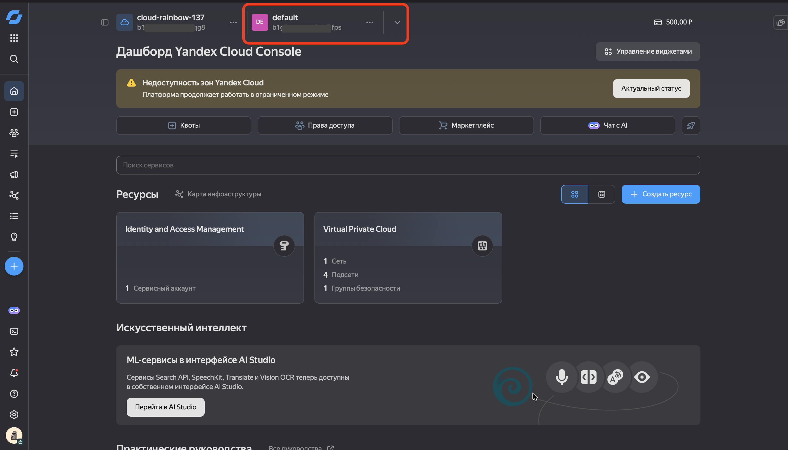
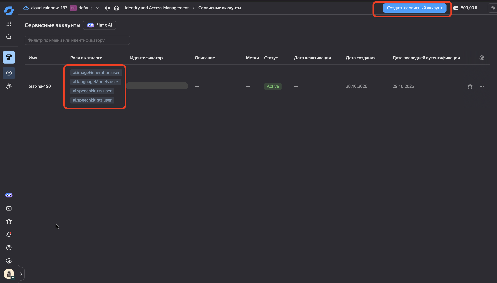
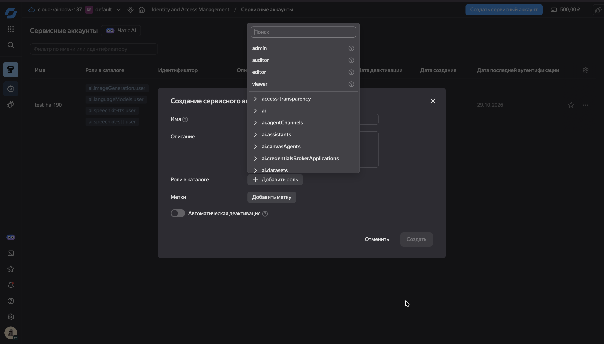
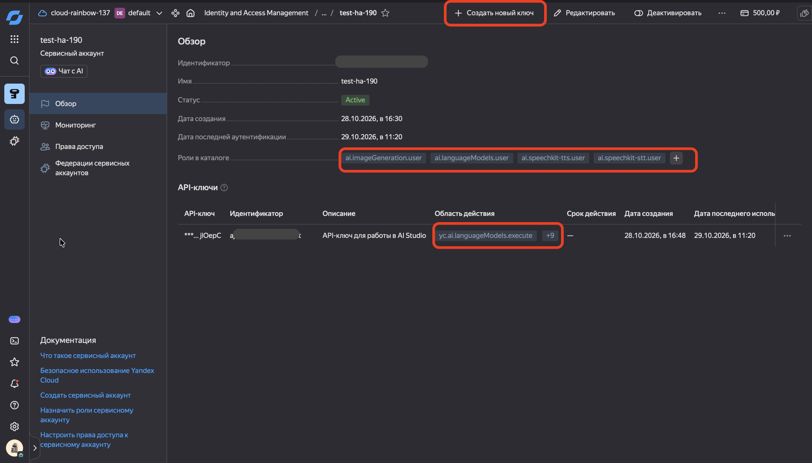

# 🔑 Как получить Folder ID и API-ключ в Yandex AI Studio / Yandex Cloud

Для работы интеграции **Yandex AI Studio** в Home Assistant вам понадобятся два параметра:
1. **Идентификатор каталога (`Folder ID`)** — строка вида `b1gxxxxxxxxxxxxxxxxx`.
2. **API-ключ (`API Key`)** — секретный ключ сервисного аккаунта вида `AQVNxxxxxxxxxxxxxxxxxxxxxxxxxxxxxxxxxxxx`.

Ниже приведена подробная пошаговая инструкция по их получению.

---

## Шаг 1. Регистрация и вход в Yandex Cloud / AI Studio

1. Перейдите в консоль **[Yandex Cloud](https://console.cloud.yandex.ru/)** или в **[Yandex AI Studio](https://aistudio.yandex.ru/)**.
2. Войдите под своим Яндекс ID.
3. Убедитесь, что у вас создан **платёжный аккаунт** и он находится в статусе `ACTIVE` (при первом подключении Яндекс предоставляет стартовый грант, которого хватает на длительное тестирование и использование в умном доме).

---

## Шаг 2. Получение `Folder ID` (Идентификатора каталога)

1. В консоли [Yandex Cloud](https://console.cloud.yandex.ru/) выберите ваше облако и откройте нужный каталог (по умолчанию он называется `default`).
2. В верхней части страницы или в списке каталогов скопируйте **Идентификатор каталога** (он начинается с `b1g...`).
   - В интерфейсе **Yandex AI Studio** (`aistudio.yandex.ru`) `Folder ID` также отображается в настройках проекта или в URL страницы после `/folders/b1g...`.

  

---

## Шаг 3. Создание сервисного аккаунта и назначение прав (ролей)

Чтобы интеграция могла обращаться одновременно к **YandexGPT** (диалог и задачи ИИ), **YandexART** (генерация картинок) и **Yandex SpeechKit** (распознавание STT и синтез речи TTS), необходимо создать сервисный аккаунт с соответствующими ролями:

1. В левом меню консоли вашего каталога перейдите в раздел **Сервисные аккаунты** (`Service accounts`).
2. Нажмите кнопку **Создать сервисный аккаунт** в правом верхнем углу.
3. Задайте имя (например, `home-assistant-ai`).
4. Нажмите **Добавить роль** и выберите следующие роли для вашего каталога:
   - `ai.languageModels.user` — для работы диалогового агента **YandexGPT** и текстовых задач **AI Task**;
   - `ai.imageGeneration.user` — для генерации изображений через **YandexART**;
   - `ai.speechkit-stt.user` — для распознавания голоса (**STT**);
   - `ai.speechkit-tts.user` — для синтеза речи (**TTS**).
   *(Альтернативно можно выдать общую роль `ai.editor` или `editor` на каталог, которая включает все перечисленные права).*
5. Нажмите **Создать**.

  
  

---

## Шаг 4. Создание `API-ключа`

1. Откройте только что созданный сервисный аккаунт (например, `home-assistant-ai`).
2. На верхней панели нажмите **Создать новый ключ** -> выберите **Создать API-ключ**.
3. В открывшемся окне:
   - Введите описание (например, `Home Assistant`).
   - В поле **Область действия** (если отображается) можно оставить пустым (будут действовать все роли сервисного аккаунта) либо отметить:
     - `yc.ai.foundationModels.execute`
     - `yc.ai.imageGeneration.execute`
     - `yc.ai.speechkitStt.execute`
     - `yc.ai.speechkitTts.execute`
   - Срок действия: **Без срока действия** (или по вашему усмотрению).
4. Нажмите **Создать**.
5. **Обязательно скопируйте и сохраните `Секретный ключ` (`AQVN...`)** — после закрытия окна увидеть его повторно будет нельзя!

  

---

## Шаг 5. Ввод данных в Home Assistant

1. В Home Assistant перейдите в **Настройки -> Устройства и службы -> Добавить интеграцию**.
2. Найдите **Yandex AI Studio**.
3. Введите:
   - **Название**: `Yandex AI Studio`
   - **Идентификатор каталога (Folder ID)**: ваш `b1g...`
   - **API-ключ**: ваш `AQVN...`
4. Нажмите **Отправить** — все 5 служб (`Conversation`, `STT`, `TTS`, `AI Task`, `AI Task image`) будут созданы автоматически!

---

## ❓ Частые ошибки и их решение

| Код ошибки | Причина | Решение |
| :--- | :--- | :--- |
| `401 Unauthorized` | Неверный API-ключ или скопирован идентификатор ключа вместо секретного ключа | Убедитесь, что вы вставили именно длинный секретный ключ, начинающийся на `AQVN...` |
| `403 Permission Denied` | У сервисного аккаунта нет прав на каталог или конкретную модель/сервис | Проверьте, что сервисному аккаунту выданы роли `ai.languageModels.user`, `ai.imageGeneration.user`, `ai.speechkit-stt.user`, `ai.speechkit-tts.user` в том же каталоге, чей `Folder ID` указан в настройках |
| `400 Invalid folderId` | Указан неверный `Folder ID` | Проверьте, что вы скопировали идентификатор каталога (`b1g...`), а не идентификатор облака (`b1g...` на уровень выше) |
| Платёжный аккаунт не активен | Истёк грант или не привязана карта в Yandex Cloud Billing | Проверьте статус биллинга в разделе [Yandex Cloud Billing](https://console.cloud.yandex.ru/billing) |

---

⬅️ **[Вернуться к основной документации (README.md)](README.md)**
