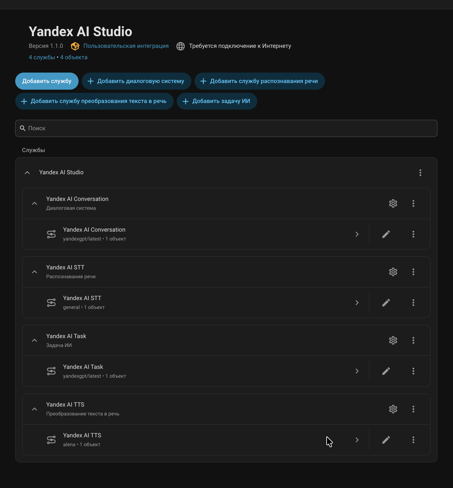
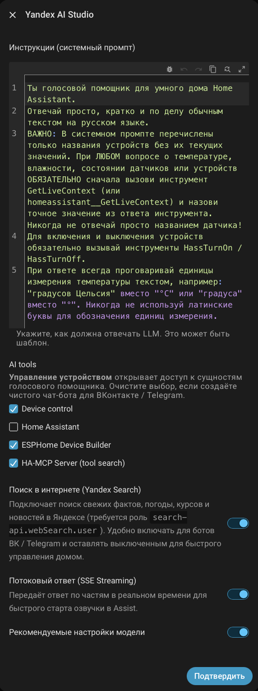
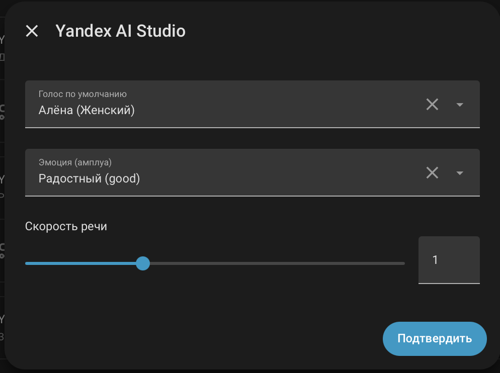
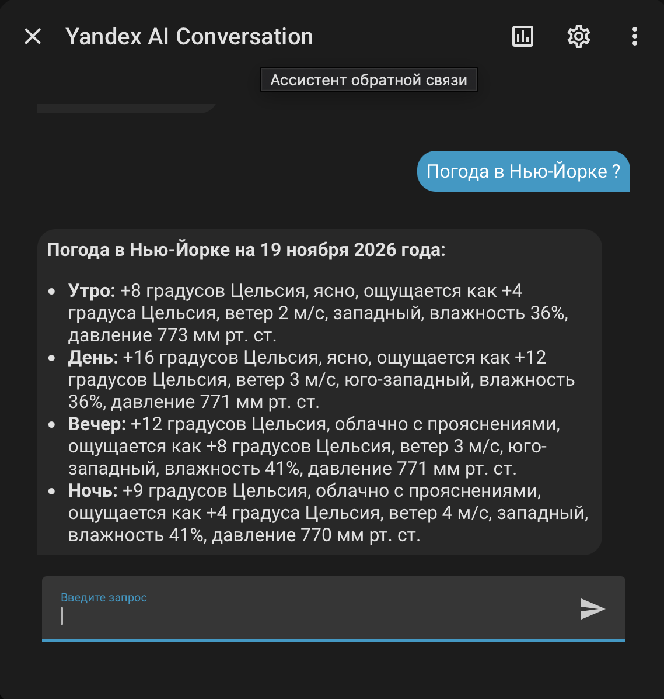
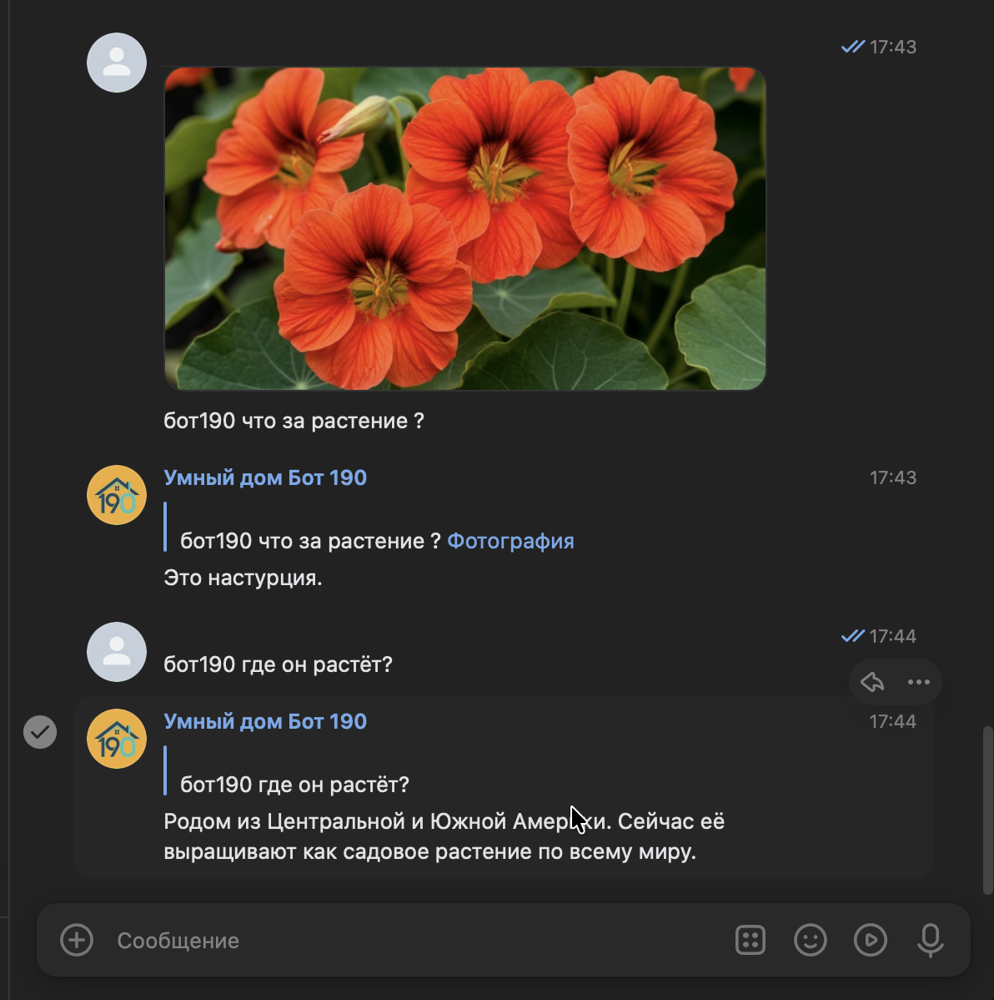

<p align="center">
  
</p>

<h1 align="center">Yandex AI Studio Integration for Home Assistant</h1>
<h2 align="center">Make your smart home truly intelligent with Yandex AI Studio!</h2>

<p align="center">
  <a href="https://github.com/hacs/integration"></a>
  <a href="https://github.com/Eugen417/HA-Yandex-generative_ai_conversation/releases"></a>
  <a href="https://github.com/Eugen417/HA-Yandex-generative_ai_conversation/releases"></a>
  <a href="https://www.home-assistant.io/"></a>
  <a href="https://opensource.org/licenses/MIT"></a>
</p>

<p align="center">
  <a href="README.md">🇷🇺 Русский</a> | <b>🇬🇧 English</b>
</p>

A full-featured **Yandex AI Studio (YandexGPT 5.1, Qwen3.6 Vision, Alice AI ART, and Yandex SpeechKit)** custom integration for **Home Assistant**, built on the modern `ConfigSubentry` and `ChatLog` service architecture (aligned with official **Google Gemini** and **Ollama** integrations, as well as [**Sber GigaChat AI**](https://github.com/Eugen417/HA-GigaChat-generative_ai_conversation)). Compatible with **Home Assistant 2025.8+ and 2026.x**.

The integration combines **5 independent AI sub-services** under a single integration entry for **Assist** voice pipelines and smart home automations:

1. 💬 **Conversation Agent (`Yandex AI Conversation`)** powered by **YandexGPT Pro 5.1 / Alice AI LLM (Flash) / DeepSeek V4.1 Flash (1M) / Qwen3.6 35B** with full smart home control (Native Tool Calling), SSE streaming, and optional Yandex Web Search.
2. 🎙 **Speech-to-Text (`Yandex AI STT`)** powered by **Yandex SpeechKit**.
3. 🔊 **Text-to-Speech (`Yandex AI TTS`)** powered by **Yandex SpeechKit** (v1, v3, and 4th-gen **LiveTTS**) with end-to-end sentence streaming.
4. 🧠 **AI Task — Text, Structured Data & Vision (`Yandex AI Task`)** — text generation, structured JSON output, and multimodal camera/image analysis (**Qwen3.6 35B Vision** — a built-in replacement for `llmvision.image_analyzer`).
5. 🎨 **AI Task — Image Generation (`Yandex AI Task image`)** — image creation powered by **Alice AI ART (`aliceai-image-art-3.0`)**.

<p align="center">
  
</p>

---

## ✨ Key Features

* 🧩 **Modern Modular Architecture (`Subentries`):** Just like *Google Gemini* and *Ollama*, each service (`Conversation`, `STT`, `TTS`, `AI Task`, `AI Task image`) is an independent service device with its own settings button ⚙️. You can add multiple conversation agents (e.g., one for smart speakers, another for Telegram bots, and a third for daily digests).
* 🏠 **Full Smart Home Control (Native Tool Calling):** Uses Home Assistant's native `ChatLog` and `llm.ToolInput` pipeline. When asked *"What is the bedroom temperature?"* or *"Turn on the kitchen lights"*, the model invokes Home Assistant tools (`GetLiveContext`, `HassTurnOn`, MCP tools, etc.), reads live states, and responds naturally. Supports selecting multiple LLM tool providers simultaneously.
* 🎭 **TTS Voice & Emotion Selection Directly in Assist (SpeechKit v1, v3 & 4th-gen LiveTTS):** Supports classic voices (*Alena, Filipp, Ermil, Jane, Madirus, Omazh, Zahar*), 3rd-generation voices (*Dasha, Julia, Lera, Masha, Marina, Alexander, Kirill, Anton, Zamira, Zhanar, Saule, Yulduz, Madi*), and 4th-generation neural **LiveTTS** voices (*Irina, Sofia, Vera, Denis, Vasily, Sergey*) with conversational roles and sentence-by-sentence streaming.
* 🔍 **Independent Yandex Web Search + "Smart Camera" (Reverse Image Search CBIR) & Chat Vision:** Separate toggles for live text Web Search (`GenSearch API v2`) and Reverse Image Search (`Yandex Images CBIR`), plus inline photo attachments in messenger chats via `[image: <URL_or_path>]`.
* 🖼 **Dedicated AI Task Entities + Camera Vision:**
  * **`Yandex AI Task`** — text/JSON generation (`ai_task.generate_data`) and **camera/image analysis (`SUPPORT_ATTACHMENTS`)** powered by **`qwen3.6-35b-a3b/latest`** (`256k` context).
  * **`Yandex AI Task image`** — image generation (`ai_task.generate_image`) powered by **Alice AI ART (`aliceai-image-art-3.0`)**.
* 📊 **Token & Estimated Cost Tracking (`sensor.py`, Beta):** Automatically creates persistent diagnostic sensors (`RestoreSensor`) for tokens, TTS characters, STT requests, generated images, and approximate cost in `RUB`.
* 🔍 **Built-in Diagnostics (`diagnostics.py`):** Exports configuration diagnostics with automatic redaction of secret API keys.

---

## 🔑 Obtaining Folder ID & API Key

Before installing and configuring the integration, you will need a **Folder ID** and an **API Key** from Yandex Cloud / Yandex AI Studio.

👉 **[Step-by-Step Illustrated Guide: How to Obtain Folder ID and API Key (API_KEY_GUIDE.md)](API_KEY_GUIDE.md)**

---

## 📦 Installation

### Option 1: Via HACS / Marketplace (Recommended)

[](https://my.home-assistant.io/redirect/hacs_repository/?owner=Eugen417&repository=HA-Yandex-generative_ai_conversation&category=integration)

1. Click the button above or open **HACS / Marketplace** in your Home Assistant instance.
2. Search for **Yandex AI Studio**, click **Download**, and **restart Home Assistant**.

### Option 2: Manual Installation

1. Download this repository (ZIP archive).
2. Copy `custom_components/yandex_generative_ai_conversation` into your Home Assistant `/config/custom_components/` directory.
3. **Restart Home Assistant**.

---

## 🛠 Configuration in Home Assistant

### 1. Adding the Integration
1. Go to **Settings -> Devices & Services -> Add Integration** and search for **Yandex AI Studio**.
2. Enter your **Folder ID** and **API Key** (see [API_KEY_GUIDE.md](API_KEY_GUIDE.md)).
3. Five default sub-services are created automatically:
   - **Yandex AI Conversation** (Conversation agent)
   - **Yandex AI STT** (Speech-to-Text)
   - **Yandex AI TTS** (Text-to-Speech)
   - **Yandex AI Task** (AI Task — text, structured data & camera Vision)
   - **Yandex AI Task image** (AI Task — Alice AI ART image generation)

You can add extra instances of any service at any time using the `+ Add ...` buttons on the integration page.

### 2. Conversation Agent Settings (`Yandex AI Conversation`)
Click the gear icon ⚙️ next to **Yandex AI Conversation**:
- **Instructions (System Prompt):** Customize the assistant's persona and behavior.
- **AI tools (`llm_hass_api`):** Select **`Device control` (`Assist`)** (and optionally non-admin MCP servers such as `HA-MCP Server`) to let the model read entity states and control devices.
  - ⚠️ **Important note on `Home Assistant` permissions & voice satellites:** the built-in **`Home Assistant`** option in `AI tools` grants full admin access and is strictly restricted by Home Assistant Core (identical to *Google Gemini* and *Ollama*) to **logged-in administrators in the browser or Companion App**. Physical voice satellites (*`ESP32-S3-Box-3`, `Home Assistant Voice PE`, `M5Stack Atom Echo`, `Wyoming`*) do not carry an admin `user_id`, so enabling **`Home Assistant`** on a satellite's agent will cause HA Core to reject voice requests with `Error getting LLM API ...: Unauthorized`. Keep **`Home Assistant` unchecked** on voice satellite agents (use `Device control` instead), and create a separate `+ Add conversation agent` if you also want an admin-level browser agent.
  - Clear all selections if creating a dedicated messenger chatbot (VK / Telegram) without device control.
- **Web Search — Text (`web_search`, default Off):** Optional **Yandex Search** tool (`GenSearch API v2`). Keep **Off** on smart-home voice control agents and turn **On** on messenger agents (VK / Telegram).
- **Reverse Image Search — Smart Camera (`image_search`, default Off):** Independent toggle for **Yandex Images CBIR** (`yandex_image_search`). When **Off**, attached photos are inspected locally by **`Qwen3.6 35B Vision`** only (reading meters, receipts, documents) without sending photos to Yandex Images search.
- **Stream responses (`streaming`, default On):** Streams SSE text chunks in real time so Assist starts speaking immediately without waiting for the full completion.
- **Recommended model settings (`recommended`):** Enabled by default (`yandexgpt-5.1`, `temperature: 0.3`, `max_tokens: 2000`). Uncheck to manually configure (dynamically enriched from `/v1/models`):
  - **Model (`chat_model`) — Base Instance Models (input / output per 1K tokens incl. VAT):**
    - `yandexgpt-5.1` — **YandexGPT Pro 5.1** (`0.80 / 0.80 RUB`, 32k — flagship for smart home control);
    - `aliceai-llm-flash` — **Alice AI LLM Flash** (`0.10 / 0.20 RUB`, 64k — ultra-fast & affordable conversational model);
    - `aliceai-llm` — **Alice AI LLM** (`0.50 / 1.20 RUB`, 128k — natural dialogue);
    - `deepseek-v4.1-flash` — **DeepSeek V4.1 Flash** (`0.30 / 0.50 RUB`, **1M context** — ideal for agents & MCP);
    - `qwen3.6-35b-a3b` — **Qwen3.6 35B Vision** (`0.20 / 0.30 RUB`, 256k — multimodal camera/image analysis & structured answers);
    - `yandexgpt-5-pro` — **YandexGPT Pro 5** (`1.20 / 1.20 RUB`, 32k), plus legacy aliases and any custom model URI.
  - **Reasoning mode (`reasoning_effort`):** `none`, `low`, `medium`, `high` — chain-of-thought reasoning depth for `Qwen3.6`, `DeepSeek V4.1`, and `Alice AI LLM`.
  - **Temperature & Max Tokens.**

<p align="center">
  
</p>

#### 💡 How Streaming, Web Search & Reasoning Work — Token & Cost Impact

| Option | Purpose & Best Use Case | Token & Billing Impact | Recommendation |
| :--- | :--- | :--- | :--- |
| **Stream responses (`SSE Streaming`)** | Delivers text chunks in real time as the model generates them. Voice satellites and **Assist** start TTS playback in **~0.5–1s** instead of waiting 4–8s for the full paragraph. Messenger automations (`conversation.process`) receive the final assembled reply either way. | **+0 tokens / 0 extra cost.** Yandex bills the exact same prompt and completion tokens as non-streaming requests. *(Note: if a specific model omits the trailing `usage` chunk in SSE mode, the HA diagnostic sensor estimates tokens from text length; turning streaming `Off` always reports exact server `usage`).* | Keep **On** for voice Assist pipelines. |
| **Web Search (`Yandex Search`)** | Lets the LLM query Yandex Search (`GenSearch API v2`) for live weather, exchange rates, news, schedules, and prices with clickable source URLs. | **Idle (enabled, not called):** ~100 input tokens per turn for the tool schema.<br>**When triggered:**<br>1) Separate Yandex Search fee (**0.915 RUB** per search);<br>2) **Second LLM pass** containing search snippets (+500–2000 tokens) **plus a second copy of the entire system prompt & exposed smart home entities**! | Keep **Off** on your main smart-home control agent (with hundreds of entities). Turn **On** on a separate **VK / Telegram** chatbot agent with `AI tools` cleared (e.g. using `aliceai-llm-flash`). |
| **Reasoning mode (`Reasoning`)** | Enables internal chain-of-thought thinking (`low` / `medium` / `high`) before answering on `Qwen3.6`, `DeepSeek V4.1`, and `Alice AI LLM`. Improves complex logic and structured data accuracy. | **Increases output tokens 2–5x.** Hidden `reasoning_content` thoughts are not spoken aloud, but are billed as `completion_tokens` and add latency. | Keep **`none` (Off)** for everyday voice control; enable selectively for complex `AI Task` or analytical bots. |

### 3. Text-to-Speech Settings (`Yandex AI TTS`)
Click the gear icon ⚙️ next to **Yandex AI TTS** to select the default voice, emotional role (`good`, `neutral`, `evil`), and speech speed (`0.1`–`3.0`, default `1.0`).

<p align="center">
  
</p>

#### Available Voices & Roles (`ru-RU` — SpeechKit v1 / v3 / LiveTTS):

| Voice | Voice ID | Gender | Engine | Supported Roles / Emotions |
| :--- | :--- | :--- | :--- | :--- |
| **Irina** | `irina` | Female | **LiveTTS (v3)** | `neutral` *(default)*, `narrator`, `formal`, `support`, `sales` |
| **Sofia / Vera** | `sofia`, `vera` | Female | **LiveTTS (v3)** | `support` *(default)*, `casual` |
| **Denis** | `denis` | Male | **LiveTTS (v3)** | `neutral` *(default)*, `casual`, `formal`, `sales` |
| **Vasily / Sergey** | `vasily`, `sergey` | Male | **LiveTTS (v3)** | `support` *(default)*, `sales` |
| **Dasha / Julia / Lera / Masha / Marina** | `dasha`, `julia`, `lera`, `masha`, `marina` | Female | SpeechKit v3 | `neutral`, `good`, `friendly`, `strict`, `whisper` |
| **Alexander / Kirill / Anton** | `alexander`, `kirill`, `anton` | Male | SpeechKit v3 | `neutral`, `good`, `strict` |
| **Zamira RU / Zhanar RU / Saule RU / Yulduz RU / Madi RU** | `zamira_ru`, `zhanar_ru`, `saule_ru`, `yulduz_ru`, `madi_ru` | F / M | SpeechKit v3 | `neutral`, `friendly`, `strict`, `whisper` |
| **Alena / Filipp / Ermil / Jane / Omazh / Zahar / Madirus** | `alena`, `filipp`, `ermil`, `jane`, `omazh`, `zahar`, `madirus` | F / M | SpeechKit v1 | `neutral`, `good`, `evil` |

*(Additional supported languages: `en-US` — `john`; `de-DE` — `lea`; `kk-KK` — `amira`, `madi`, `saule`, `zhanar`; `uz-UZ` — `nigora`, `zamira`, `lola`, `yulduz`; `he-IL` — `naomi` (`modern`, `classic`). Note: `speed` and `pitch_shift` are omitted automatically for `LiveTTS` voices per Yandex API specification.)*

### 4. Setting Up **Assist** Voice Pipeline
1. Go to **Settings -> Voice Assistants** and create or edit an assistant.
2. Select **`Yandex AI Conversation`**, **`Yandex AI STT`**, and **`Yandex AI TTS`** (enable **"Prefer handling commands locally"** so simple commands run locally at 0 tokens). `Yandex AI TTS` supports **end-to-end sentence-by-sentence audio streaming (`async_stream_tts_audio`)** into a seamless `WAV PCM` stream for both v3 and v1 voices.

> ⚠️ **Voice Satellite Reminder (`ESP32-S3-Box-3`, `Home Assistant Voice PE`, `Atom Echo`, `Wyoming`):** make sure the **`Home Assistant`** checkbox in **`AI tools`** is **unchecked** on the conversation agent assigned to your voice satellite (keep **`Device control`** enabled), otherwise HA Core will reject satellite voice commands with `Unauthorized`.

<p align="center">
  
</p>

<p align="center">
  
</p>

---

## 📊 Token & Estimated Cost Tracking (Beta)

Each of the 5 sub-services automatically provides persistent diagnostic sensors (`RestoreSensor`):
- **`Yandex AI Conversation` & `Yandex AI Task`**:
  - **Tokens Used (`tokens`)** — total tokens (sensor attributes expose `input_tokens`, `output_tokens`, `last_request_tokens`, `requests_count`, `last_model`).
  - **Cost (`RUB`)** — approximate cost in Russian rubles.
- **`Yandex AI Task image`**: **Images Generated (`img`)** and **Cost (`RUB`)**.
- **`Yandex AI TTS`**: **Characters Synthesized (`chars`)** and **Cost (`RUB`)**.
- **`Yandex AI STT`**: **Requests Recognized (`req`)** and **Cost (`RUB`)**.

> ⚠️ **Note:** RUB cost tracking operates in **Beta (informational) mode** and may differ from actual charges in Yandex Cloud Billing, as it uses public base unit rates and does not account for trial grants, custom discounts, billing rounding, or price-list updates.

---

## 🎨 Using AI Task (Image Generation, Structured Data & Camera Vision)

The integration provides two dedicated `ai_task` entities:
- **`Yandex AI Task`** (`ai_task.yandex_ai_task`) — text & structured JSON generation (`ai_task.generate_data`) via **YandexGPT Pro 5.1**, plus multimodal camera/image analysis via **Qwen3.6 35B Vision (`qwen3.6-35b-a3b/latest`)**.
- **`Yandex AI Task image`** (`ai_task.yandex_ai_task_image`) — image generation (`ai_task.generate_image`) via **Alice AI ART (`aliceai-image-art-3.0`)**.

### Example 1: Generate an Image with Alice AI ART (`ai_task.generate_image`)

```yaml
action: ai_task.generate_image
data:
  entity_id: ai_task.yandex_ai_task_image
  task_name: "Today's weather"
  instructions: "A cozy smart home in an autumn forest, warm glowing windows, cinematic lighting"
response_variable: generated_image
```

### Example 2: Generate Structured Data with YandexGPT (`ai_task.generate_data`)

```yaml
action: ai_task.generate_data
data:
  entity_id: ai_task.yandex_ai_task
  task_name: "Morning home summary"
  instructions: "Write a concise morning greeting summary based on the outdoor weather and bedroom temperature."
response_variable: summary
```

### Example 3: Camera & Image Vision Analysis (`ai_task.generate_data` + `attachments`)

`Yandex AI Task` supports `SUPPORT_ATTACHMENTS` and automatically analyzes attached camera snapshots or images using **`qwen3.6-35b-a3b`**:

```yaml
action: ai_task.generate_data
data:
  entity_id: ai_task.yandex_ai_task
  task_name: "Front door camera check"
  instructions: "Describe what is happening on the camera. Are there any people or vehicles?"
  attachments:
    - media_content_id: media-source://camera/camera.front_door
      media_content_type: image/jpeg
response_variable: camera_analysis
```

---

## 🔍 Web Search (`Yandex Search`), Vision & Reverse Image Search ("Smart Camera")

The integration separates **local multimodal image inspection (`Vision`)**, **text Web Search (`web_search`)**, and **Reverse Image Search (`image_search`)** into independent controls so you have full control over both photo privacy and billing costs.

### 1. Three Modes for Web & Photo Intelligence

| Mode | Tool / Endpoint | What It Does | Extra Search Fee |
| :--- | :--- | :--- | :--- |
| **👁 Local AI Vision Only (`Vision`)** | Multimodal `/v1/chat/completions` (`image_url`) | Reads utility meters, receipts, documents, error screens, and describes security camera snapshots **without uploading photos to any search engine**. | **0 RUB** *(LLM tokens only)* |
| **🌐 Text Web Search (`web_search`)** | `yandex_web_search` (`POST /v2/gen/search` + `/v1/responses` fallback) | Fetches live weather forecasts, exchange rates, breaking news, prices, and schedules, returning answers with clickable `sources`. | **0.915 RUB** *(only when search is actually invoked)* |
| **📷 Reverse Image Search (`image_search`)** | `yandex_image_search` (`POST /v2/image/search_by_image` CBIR) | **Yandex Smart Camera**: searches attached photos across Yandex Images to identify exact plant species, products, spare parts, landmarks, or brands, returning matching web pages and store links. | **0.915 RUB** *(only when image search is invoked)* |

### 2. Yandex Cloud IAM Role Requirements

Both **Web Search** and **Reverse Image Search** require the **`search-api.webSearch.user`** role on your service account (note that `ai.editor` covers `ai.*` only and **does not** grant `search-api.*` access!):
- 🚀 **1-Click Setup:** creating a key via the **"Create API key"** button in the top-right corner of **[Yandex AI Studio](https://aistudio.yandex.ru/)** automatically assigns all required roles including `search-api`.
- 🛠 **Manual Setup in Yandex Cloud Console:** assign **`search-api.webSearch.user`** to your service account and leave the API key *Scopes* field empty (or include `yc.search-api.execute`) — see **[API_KEY_GUIDE.md](API_KEY_GUIDE.md)**.

### 3. Model Requirements (Especially for Reverse Image Search!)

* **For Text Web Search (`Web Search`):** works with any model that supports **Function Calling (`tools`)**: `yandexgpt-5.1/latest` *(default)*, ultra-fast `aliceai-llm-flash/latest`, `aliceai-llm/latest`, `deepseek-v4.1-flash/latest`, `qwen3.6-35b-a3b/latest`.
* **For Photo Analysis & Reverse Image Search (`Reverse Image Search`):** requires a multimodal model that supports **both image inputs (`Vision`) AND Function Calling (`tools`)** simultaneously:
  * ✅ **Recommended Model — `Qwen3.6 35B Vision` (`qwen3.6-35b-a3b/latest`, `0.20 / 0.30 RUB` per 1K, 256k context):** natively inspects the photo, decides when to call `yandex_image_search`, cross-checks Yandex Images results against your photo, and delivers an accurate answer (multimodal `deepseek-v4.1-flash/latest` is also supported).
  * ✅ **Automatic Vision Model Switching:** if you keep **"Recommended model settings" = On** (`yandexgpt-5.1/latest`) or select a text-only model (`aliceai-llm-flash/latest`, `aliceai-llm/latest`, `yandexgpt-5-pro/latest`), the integration **automatically switches** any turn containing an image to **`qwen3.6-35b-a3b/latest`**, while keeping your chosen model for regular text turns!
  * ⚠️ **Important Limitation of `Gemma 3 27B Vision` (`gemma-3-27b-it/latest`):** this `[legacy]` model only describes images as plain text and **does NOT support Function Calling (`tools`)** in Yandex AI Studio. Do **not** select `Gemma 3` on agents where *Reverse Image Search*, *Web Search*, or *AI tools* are enabled — use **`Qwen3.6 35B Vision` (`qwen3.6-35b-a3b/latest`)** instead.

### 4. Step-by-Step `Conversation` Agent Setup for Search & Smart Camera

Using `Subentries`, the recommended best practice is to split smart-home voice control and messenger search into **two separate conversation agents**:

1. **Agent #1 — `Yandex AI Conversation` (for Voice Speakers & Assist):**
   - `AI tools`: check `Device control` *(keep admin `Home Assistant` unchecked for voice satellites)*;
   - `Web Search`: **Off**, `Reverse Image Search`: **Off** — ensures instant device control without re-sending your entire entity list on a second pass.
2. **Agent #2 — click `+ Add conversation agent` and create e.g. `Yandex Chat Bot` (for VKontakte / Telegram):**
   - Click the gear icon ⚙️ next to the new agent:
   - **AI tools:** clear all selections (for a safe family/group chatbot without switch access) or keep `Device control` if you want device control from chat;
   - **Web Search (Yandex Search — text):** turn **On**;
   - **Reverse Image Search (Yandex Images — Smart Camera):** turn **On** *(to identify plants, products, and parts via Yandex Images)* or keep **Off** *(if you only want `Qwen3.6 Vision` to read meters/receipts locally)*;
   - **Recommended model settings:** keep **On** (automatic `Qwen3.6 Vision` fallback on photo turns) or uncheck and explicitly select **`Qwen3.6 35B Vision` (`qwen3.6-35b-a3b/latest`)** as the primary chatbot model.
3. **Passing Photos to `conversation.process`:**
   - Append **`[image: <URL_or_local_path>]`** to the `text` field in your automation (supports `https://...` VKontakte photo URLs as well as local files in `/config`, `/media`, `/share`, `/tmp` downloaded via `telegram_bot.download_file`).
   - The integration automatically downloads the image, normalizes it to `JPEG <= 2.5 MB`, passes it to `Qwen3.6 35B Vision`, and preserves dialogue context via `conversation_id` so users can ask natural follow-up questions about the identified object!

<p align="center">
  
  
</p>

<p align="center">
  
</p>

---

## 💬 Automation Examples: VKontakte (VK Notify) & Telegram Chatbots

All ready-to-import YAML automations (**100% compatible with Home Assistant's Visual Editor UI blocks**) are available in English under **[`examples/en/`](examples/README.en.md)** (and in Russian under **[`examples/`](examples/README.md)**):

| Example File (EN / RU) | Description |
| :--- | :--- |
| 📄 **[`examples/en/vk_chatbot.yaml`](examples/en/vk_chatbot.yaml)** / **[`ru`](examples/vk_chatbot.yaml)** | **VKontakte AI Chatbot** ([VK Notify](https://github.com/Eugen417/ha_vk_notify_plus)): natural 1-on-1 DM chat + `Bot190` wake word in group chats, text, voice (`transcript`), and photo attachments (`[image: <url>]`) with multi-turn memory. |
| 📄 **[`examples/en/vk_camera_vision.yaml`](examples/en/vk_camera_vision.yaml)** / **[`ru`](examples/vk_camera_vision.yaml)** | **VKontakte `/camera` Command**: captures a camera snapshot and sends an AI scene report via `Qwen3.6 35B Vision`. |
| 📄 **[`examples/en/telegram_chatbot.yaml`](examples/en/telegram_chatbot.yaml)** / **[`ru`](examples/telegram_chatbot.yaml)** | **Telegram AI Chatbot** (`telegram_bot`, HA 2026+ schema): replies immediately in DMs (`chat_id > 0`) and on `Bot190` wake word in groups (`chat_id < 0`), supports text & photos (`telegram_bot.download_file`) and `typing` indicator. |
| 📄 **[`examples/en/ai_task_examples.yaml`](examples/en/ai_task_examples.yaml)** / **[`ru`](examples/ai_task_examples.yaml)** | Action snippets for `ai_task.generate_image` (*Alice AI ART*) and `ai_task.generate_data` (summaries & camera Vision). |
| 📖 **[`examples/README.en.md`](examples/README.en.md)** / **[`README.md`](examples/README.md)** | 1-minute UI setup guide, model selection tips, and photo privacy controls (`Qwen3.6 Vision` only vs `Reverse Image Search`). |

---

## 📂 Repository Structure

```text
HA-Yandex-generative_ai_conversation/
├── .github/workflows/          # GitHub Actions (Hassfest & HACS Validation, Release)
├── custom_components/
│   └── yandex_generative_ai_conversation/
│       ├── __init__.py         # Integration setup and Subentries lifecycle
│       ├── ai_task.py          # AI Task platform (YandexGPT + Vision + Alice AI ART)
│       ├── brand/              # Local brand icons and logos (icon.png, logo.png)
│       ├── config_flow.py      # Setup wizard and ConfigSubentryFlow
│       ├── const.py            # Constants, models, pricing, and voices/roles
│       ├── conversation.py     # Conversation agent for Assist
│       ├── diagnostics.py      # Integration diagnostics with key redaction
│       ├── entity.py           # Base LLM client, SSE streaming, Vision & Tool Calling
│       ├── helpers.py          # Auth headers (Api-Key/IAM), /v1/models, Web & Image Search
│       ├── manifest.json       # Home Assistant integration manifest
│       ├── sensor.py           # Token, request, and estimated cost (RUB) sensors
│       ├── strings.json        # Localization strings
│       ├── stt.py              # Speech-to-Text (Yandex SpeechKit STT)
│       ├── tts.py              # Streaming Text-to-Speech (SpeechKit v1, v3 & LiveTTS)
│       └── translations/       # Translations (en.json, ru.json)
├── examples/                   # Ready-to-use YAML automations (RU + examples/en/ EN)
├── images/                     # Documentation screenshots
├── API_KEY_GUIDE.md            # Step-by-step guide to obtaining Folder ID & API Key
├── CHANGELOG.md                # Release history
├── LICENSE                     # MIT License
├── README.en.md                # English documentation
├── README.md                   # Russian documentation
└── hacs.json                   # HACS manifest
```

---

## 📄 License

This project is distributed under the **MIT License**. See [LICENSE](LICENSE) for details.


