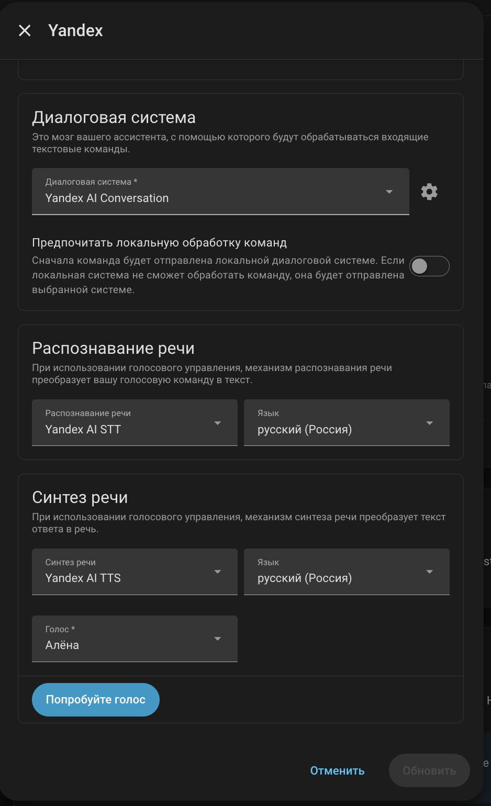
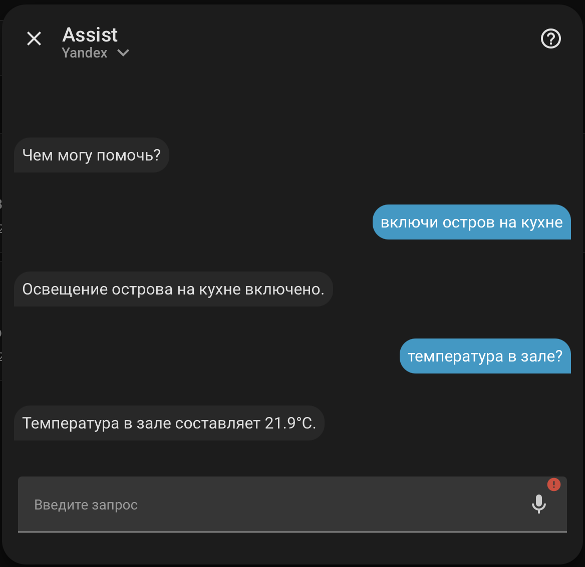
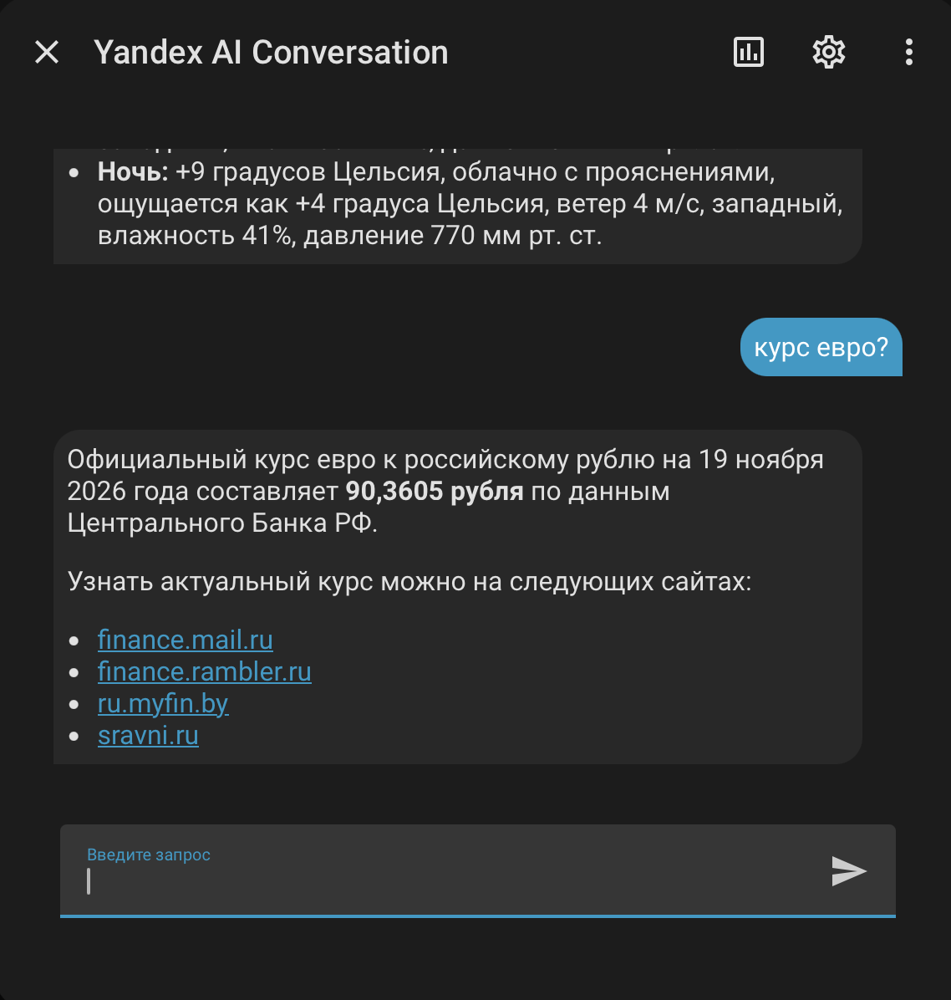

<p align="center">
  
</p>

<h1 align="center">Yandex AI Studio Integration for Home Assistant</h1>
<h2 align="center">Make your smart home truly intelligent with Yandex AI Studio!</h2>

<p align="center">
  <a href="https://github.com/hacs/integration"></a>
  <a href="https://github.com/Eugen417/HA-Yandex-generative_ai_conversation/releases"></a>
  <a href="https://github.com/Eugen417/HA-Yandex-generative_ai_conversation/releases"></a>
  <a href="https://www.home-assistant.io/"></a>
  <a href="https://opensource.org/licenses/MIT"></a>
</p>

<p align="center">
  <a href="README.md">🇷🇺 Русский</a> | <b>🇬🇧 English</b>
</p>

A full-featured **Yandex AI Studio (YandexGPT, Alice AI ART, Gemma 3 Vision, and Yandex SpeechKit)** custom integration for **Home Assistant**, built on the modern `ConfigSubentry` and `ChatLog` service architecture (aligned with official **Google Gemini** and **Ollama** integrations, as well as [**Sber GigaChat AI**](https://github.com/Eugen417/HA-GigaChat-generative_ai_conversation)). Compatible with **Home Assistant 2025.8+ and 2026.x**.

The integration combines **5 independent AI sub-services** under a single integration entry for **Assist** voice pipelines and smart home automations:

1. 💬 **Conversation Agent (`Yandex AI Conversation`)** powered by **YandexGPT / AliceAI / Qwen3** with full smart home control (Native Tool Calling).
2. 🎙 **Speech-to-Text (`Yandex AI STT`)** powered by **Yandex SpeechKit**.
3. 🔊 **Text-to-Speech (`Yandex AI TTS`)** powered by **Yandex SpeechKit** (API v1 + API v3) with selectable language, voice, emotion/role, and speech speed.
4. 🧠 **AI Task — Text, Structured Data & Vision (`Yandex AI Task`)** — text generation, structured JSON output (**YandexGPT**), and multimodal camera/image analysis (**Gemma 3 27B Vision** — a built-in replacement for `llmvision.image_analyzer`).
5. 🎨 **AI Task — Image Generation (`Yandex AI Task image`)** — image creation powered by **Alice AI ART (`aliceai-image-art-3.0`)**.

<p align="center">
  
</p>

---

## ✨ Key Features

* 🧩 **Modern Modular Architecture (`Subentries`):** Just like *Google Gemini* and *Ollama*, each service (`Conversation`, `STT`, `TTS`, `AI Task`, `AI Task image`) is an independent service device with its own settings button ⚙️. You can add multiple conversation agents (e.g., one for smart speakers, another for Telegram bots, and a third for daily digests).
* 🏠 **Full Smart Home Control (Native Tool Calling):** Uses Home Assistant's native `ChatLog` and `llm.ToolInput` pipeline. When asked *"What is the bedroom temperature?"* or *"Turn on the kitchen lights"*, the model invokes Home Assistant tools (`GetLiveContext`, `HassTurnOn`, MCP tools, etc.), reads live states, and responds naturally. Supports selecting multiple LLM tool providers simultaneously.
* 🎭 **TTS Voice & Emotion Selection Directly in Assist (SpeechKit API v1 + API v3):** Supports both classic Yandex SpeechKit voices (*Alena, Filipp, Ermil, Jane, Madirus, Omazh, Zahar*) and 3rd-generation voices (*Dasha, Julia, Lera, Masha, Marina, Alexander, Kirill, Anton*) along with emotional roles (*Good/Joyful, Friendly, Strict, Whisper, Neutral, Evil*) right from the **Assist** pipeline dropdown.
* 🖼 **Dedicated AI Task Entities + Camera Vision:**
  * **`Yandex AI Task`** — text/JSON generation (`ai_task.generate_data`) and **camera/image analysis (`SUPPORT_ATTACHMENTS`)** powered by **`gemma-3-27b-it/latest`**.
  * **`Yandex AI Task image`** — image generation (`ai_task.generate_image`) powered by **Alice AI ART (`aliceai-image-art-3.0`)**.
* 📊 **Token & Estimated Cost Tracking (`sensor.py`, Beta):** Automatically creates persistent diagnostic sensors (`RestoreSensor`) for tokens, TTS characters, STT requests, generated images, and approximate cost in `RUB`.
* 🔍 **Built-in Diagnostics (`diagnostics.py`):** Exports configuration diagnostics with automatic redaction of secret API keys.

---

## 🔑 Obtaining Folder ID & API Key

Before installing and configuring the integration, you will need a **Folder ID** and an **API Key** from Yandex Cloud / Yandex AI Studio.

👉 **[Step-by-Step Illustrated Guide: How to Obtain Folder ID and API Key (API_KEY_GUIDE.md)](API_KEY_GUIDE.md)**

---

## 📦 Installation

### Option 1: Via HACS / Marketplace (Recommended)

[](https://my.home-assistant.io/redirect/hacs_repository/?owner=Eugen417&repository=HA-Yandex-generative_ai_conversation&category=integration)

1. Click the button above or open **HACS / Marketplace** in your Home Assistant instance.
2. Search for **Yandex AI Studio**, click **Download**, and **restart Home Assistant**.

### Option 2: Manual Installation

1. Download this repository (ZIP archive).
2. Copy `custom_components/yandex_generative_ai_conversation` into your Home Assistant `/config/custom_components/` directory.
3. **Restart Home Assistant**.

---

## 🛠 Configuration in Home Assistant

### 1. Adding the Integration
1. Go to **Settings -> Devices & Services -> Add Integration** and search for **Yandex AI Studio**.
2. Enter your **Folder ID** and **API Key** (see [API_KEY_GUIDE.md](API_KEY_GUIDE.md)).
3. Five default sub-services are created automatically:
   - **Yandex AI Conversation** (Conversation agent)
   - **Yandex AI STT** (Speech-to-Text)
   - **Yandex AI TTS** (Text-to-Speech)
   - **Yandex AI Task** (AI Task — text, structured data & camera Vision)
   - **Yandex AI Task image** (AI Task — Alice AI ART image generation)

You can add extra instances of any service at any time using the `+ Add ...` buttons on the integration page.

### 2. Conversation Agent Settings (`Yandex AI Conversation`)
Click the gear icon ⚙️ next to **Yandex AI Conversation**:
- **Instructions (System Prompt):** Customize the assistant's persona and behavior.
- **AI tools (`llm_hass_api`):** Select **`Device control` (`Assist`)** (and optionally non-admin MCP servers such as `HA-MCP Server`) to let the model read entity states and control devices.
  - ⚠️ **Important note on `Home Assistant` permissions & voice satellites:** the built-in **`Home Assistant`** option in `AI tools` grants full admin access and is strictly restricted by Home Assistant Core (identical to *Google Gemini* and *Ollama*) to **logged-in administrators in the browser or Companion App**. Physical voice satellites (*`ESP32-S3-Box-3`, `Home Assistant Voice PE`, `M5Stack Atom Echo`, `Wyoming`*) do not carry an admin `user_id`, so enabling **`Home Assistant`** on a satellite's agent will cause HA Core to reject voice requests with `Error getting LLM API ...: Unauthorized`. Keep **`Home Assistant` unchecked** on voice satellite agents (use `Device control` instead), and create a separate `+ Add conversation agent` if you also want an admin-level browser agent.
  - Clear all selections if creating a dedicated messenger chatbot (VK / Telegram) without device control.
- **Web Search (`web_search`, default Off):** Optional **Yandex Search** tool (`GenSearch API v2` / `Responses API`). Keep **Off** for smart home voice control (for minimal latency) and turn **On** for a second messenger agent (VK / Telegram) so it can answer questions about weather, news, exchange rates, and live events.
- **Stream responses (`streaming`, default On):** Streams SSE text chunks in real time so Assist starts speaking immediately without waiting for the full completion.
- **Recommended model settings (`recommended`):** Enabled by default (`yandexgpt/latest`, `temperature: 0.3`, `max_tokens: 2000`). Uncheck to manually configure (dynamically enriched from `/v1/models`):
  - **Model (`chat_model`):** `yandexgpt/latest`, `yandexgpt-lite/latest`, `aliceai-llm/latest`, `gemma-3-27b-it/latest`, `qwen3-235b-a22b-fp8/latest`, `yandexgpt/rc`, `yandexgpt-lite/rc` (or any custom model URI).
  - **Reasoning mode (`reasoning_effort`):** `none`, `low`, `medium`, `high` — chain-of-thought reasoning depth for `Qwen3 235B` and latest Yandex models.
  - **Temperature & Max Tokens.**

<p align="center">
  
</p>

#### 💡 How Streaming, Web Search & Reasoning Work — Token & Cost Impact

| Option | Purpose & Best Use Case | Token & Billing Impact | Recommendation |
| :--- | :--- | :--- | :--- |
| **Stream responses (`SSE Streaming`)** | Delivers text chunks in real time as the model generates them. Voice satellites and **Assist** start TTS playback in **~0.5–1s** instead of waiting 4–8s for the full paragraph. Messenger automations (`conversation.process`) receive the final assembled reply either way. | **+0 tokens / 0 extra cost.** Yandex bills the exact same prompt and completion tokens as non-streaming requests. *(Note: if a specific model omits the trailing `usage` chunk in SSE mode, the HA diagnostic sensor estimates tokens from text length; turning streaming `Off` always reports exact server `usage`).* | Keep **On** for voice Assist pipelines. |
| **Web Search (`Yandex Search`)** | Lets the LLM query Yandex Search (`GenSearch API v2`) for live weather, exchange rates, news, schedules, and prices with clickable source URLs. | **Idle (enabled, not called):** ~100 input tokens per turn for the tool schema.<br>**When triggered:**<br>1) Separate Yandex Search API fee (**~0.40 RUB** per search);<br>2) **Second LLM pass** containing search snippets (+500–2000 tokens) **plus a second copy of the entire system prompt & exposed smart home entities**! | Keep **Off** on your main smart-home control agent (with hundreds of entities). Turn **On** on a separate **VK / Telegram** chatbot agent with `AI tools` cleared. |
| **Reasoning mode (`Reasoning`)** | Enables internal chain-of-thought thinking (`low` / `medium` / `high`) before answering on `Qwen3 235B` and latest Yandex models. Improves complex logic and structured data accuracy. | **Increases output tokens 2–5x.** Hidden `reasoning_content` thoughts are not spoken aloud, but are billed as `completion_tokens` and add latency. | Keep **`none` (Off)** for everyday voice control; enable selectively for complex `AI Task` or analytical bots. |

### 3. Text-to-Speech Settings (`Yandex AI TTS`)
Click the gear icon ⚙️ next to **Yandex AI TTS** to select the default voice, emotional role (`good`, `neutral`, `evil`), and speech speed (`0.1`–`3.0`, default `1.0`).

<p align="center">
  
</p>

#### Available Voices & Emotions (`ru-RU`):

| Voice | Voice ID | Gender | Supported Emotions |
| :--- | :--- | :--- | :--- |
| **Alena** | `alena` | Female | `neutral`, `good` |
| **Filipp** | `filipp` | Male | `neutral` |
| **Ermil** | `ermil` | Male | `neutral`, `good` |
| **Jane** | `jane` | Female | `neutral`, `good`, `evil` |
| **Omazh** | `omazh` | Female | `neutral`, `evil` |
| **Zahar** | `zahar` | Male | `neutral`, `good` |
| **Madirus** | `madirus` | Male | `neutral` |
| **Dasha / Julia / Lera / Masha / Marina** | `dasha`, `julia`, `lera`, `masha`, `marina` | Female | `neutral` (+ SpeechKit v3 roles) |
| **Alexander / Kirill / Anton** | `alexander`, `kirill`, `anton` | Male | `neutral` (+ SpeechKit v3 roles) |

*(Additional supported languages: `en-US` — `john`; `de-DE` — `lea`; `kk-KK` — `amira`, `madi`, `saule`, `zhanar`; `uz-UZ` — `nigora`, `lola`, `yulduz`; `he-IL` — `naomi`.)*

### 4. Setting Up **Assist** Voice Pipeline
1. Go to **Settings -> Voice Assistants** and create or edit an assistant.
2. Select **`Yandex AI Conversation`**, **`Yandex AI STT`**, and **`Yandex AI TTS`** (enable **"Prefer handling commands locally"** so simple commands run locally at 0 tokens). `Yandex AI TTS` supports **end-to-end sentence-by-sentence audio streaming (`async_stream_tts_audio`)** into a seamless `WAV PCM` stream for both v3 and v1 voices.

> ⚠️ **Voice Satellite Reminder (`ESP32-S3-Box-3`, `Home Assistant Voice PE`, `Atom Echo`, `Wyoming`):** make sure the **`Home Assistant`** checkbox in **`AI tools`** is **unchecked** on the conversation agent assigned to your voice satellite (keep **`Device control`** enabled), otherwise HA Core will reject satellite voice commands with `Unauthorized`.

<p align="center">
  
</p>

<p align="center">
  
</p>

---

## 📊 Token & Estimated Cost Tracking (Beta)

Each of the 5 sub-services automatically provides persistent diagnostic sensors (`RestoreSensor`):
- **`Yandex AI Conversation` & `Yandex AI Task`**:
  - **Tokens Used (`tokens`)** — total tokens (sensor attributes expose `input_tokens`, `output_tokens`, `last_request_tokens`, `requests_count`, `last_model`).
  - **Cost (`RUB`)** — approximate cost in Russian rubles.
- **`Yandex AI Task image`**: **Images Generated (`img`)** and **Cost (`RUB`)**.
- **`Yandex AI TTS`**: **Characters Synthesized (`chars`)** and **Cost (`RUB`)**.
- **`Yandex AI STT`**: **Requests Recognized (`req`)** and **Cost (`RUB`)**.

> ⚠️ **Note:** RUB cost tracking operates in **Beta (informational) mode** and may differ from actual charges in Yandex Cloud Billing, as it uses public base unit rates and does not account for trial grants, custom discounts, billing rounding, or price-list updates.

---

## 🎨 Using AI Task (Image Generation, Structured Data & Camera Vision)

The integration provides two dedicated `ai_task` entities:
- **`Yandex AI Task`** (`ai_task.yandex_ai_task`) — text & structured JSON generation (`ai_task.generate_data`) via **YandexGPT**, plus multimodal camera/image analysis via **Gemma 3 27B Vision**.
- **`Yandex AI Task image`** (`ai_task.yandex_ai_task_image`) — image generation (`ai_task.generate_image`) via **Alice AI ART (`aliceai-image-art-3.0`)**.

### Example 1: Generate an Image with Alice AI ART (`ai_task.generate_image`)

```yaml
action: ai_task.generate_image
data:
  entity_id: ai_task.yandex_ai_task_image
  task_name: "Today's weather"
  instructions: "A cozy smart home in an autumn forest, warm glowing windows, cinematic lighting"
response_variable: generated_image
```

### Example 2: Generate Structured Data with YandexGPT (`ai_task.generate_data`)

```yaml
action: ai_task.generate_data
data:
  entity_id: ai_task.yandex_ai_task
  task_name: "Morning home summary"
  instructions: "Write a concise morning greeting summary based on the outdoor weather and bedroom temperature."
response_variable: summary
```

### Example 3: Camera & Image Vision Analysis (`ai_task.generate_data` + `attachments`)

`Yandex AI Task` supports `SUPPORT_ATTACHMENTS` and automatically analyzes attached camera snapshots or images using **`gemma-3-27b-it/latest`**:

```yaml
action: ai_task.generate_data
data:
  entity_id: ai_task.yandex_ai_task
  task_name: "Front door camera check"
  instructions: "Describe what is happening on the camera. Are there any people or vehicles?"
  attachments:
    - media_content_id: media-source://camera/camera.front_door
      media_content_type: image/jpeg
response_variable: camera_analysis
```

---

## 💬 Automation Examples: VKontakte (VK Notify) & Telegram Chatbots with Web Search

Thanks to the `Subentries` architecture, you can split responsibilities between two separate conversation agents inside **Yandex AI Studio**:
1. **`Yandex AI Conversation`** (for voice speakers & Assist): `AI tools = Assist`, **`Web Search = Off`** — ultra-fast smart home control.
2. Click **`+ Add conversation agent`** and create **`Yandex Chat Bot`** (`conversation.yandex_bot_chata`): clear `AI tools` (or select read-only tools), enable **`Web Search (Yandex Search) = On`**, and choose a model such as `aliceai-llm/latest`, `qwen3-235b-a22b-fp8/latest`, or `yandexgpt-lite/latest`. *(Make sure your service account has the `search-api.webSearch.user` role — see [API_KEY_GUIDE.md](API_KEY_GUIDE.md)).*

<p align="center">
  
  
</p>

### Example 1: VKontakte AI Chatbot (Text + Voice Messages + Web Search) via [VK Notify](https://github.com/Eugen417/ha_vk_notify_plus)

```yaml
alias: "VK: Yandex AI Chatbot (Live DM + Wake Word 'Bot190' in Group Chats)"
mode: queued
max: 10
triggers:
  - trigger: event
    event_type: vk_notify_text
variables:
  raw_query: >-
    {{ (trigger.event.data.text
        if (trigger.event.data.text | default('') | trim) != ''
        else (trigger.event.data.transcript | default(''))) | trim }}
  is_private_chat: "{{ (trigger.event.data.peer_id | int(0)) < 2000000000 }}"
  wake_pattern: "^(?:\\[club\\d+\\|[^\\]]+\\]\\s*)?(?:бот|bot)\\s*190\\b[,:\\s-]*"
  is_addressed_to_bot: "{{ raw_query is search(wake_pattern, ignorecase=True) }}"
  clean_query: >-
    {{ (raw_query | regex_replace(wake_pattern, '', ignorecase=True) | trim)
       if is_addressed_to_bot else raw_query }}
conditions:
  # 1. Ignore messages from unconfigured VK chats
  - condition: template
    value_template: "{{ trigger.event.data.entity_id != 'not_configured' }}"
  # 2. Whitelist allowed VKontakte user IDs (from_id)
  - condition: template
    value_template: "{{ trigger.event.data.from_id in [123456789, 987654321] }}"
  # 3. Direct messages: natural conversation; Group chats: require wake word 'Bot190'
  - condition: template
    value_template: "{{ clean_query != '' and (is_private_chat or is_addressed_to_bot) }}"
actions:
  - action: vk_notify.set_activity
    target:
      entity_id: "{{ trigger.event.data.entity_id }}"
    data:
      type: typing
  - action: conversation.process
    data:
      agent_id: conversation.yandex_bot_chata
      text: "{{ clean_query }}"
      conversation_id: "vk_{{ trigger.event.data.peer_id }}"
    response_variable: ai_reply
  - action: vk_notify.send_message
    target:
      entity_id: "{{ trigger.event.data.entity_id }}"
    data:
      message: "{{ ai_reply.response.speech.plain.speech }}"
      parse_mode: markdownv2
      reply_to: "{{ trigger.event.data.conversation_message_id }}"
```

### Example 2: Telegram AI Chatbot (`telegram_bot`) with Yandex Web Search

```yaml
alias: "Telegram: Yandex AI Studio Chatbot (Live DM + Wake Word 'Bot190' in Groups)"
mode: queued
max: 10
triggers:
  - trigger: event
    event_type: telegram_text
variables:
  raw_query: "{{ trigger.event.data.text | default('') | trim }}"
  is_private_chat: "{{ (trigger.event.data.chat_id | int(0)) > 0 }}"
  wake_pattern: "^(?:@\\w+\\s*)?(?:бот|bot)\\s*190\\b[,:\\s-]*"
  is_addressed_to_bot: "{{ raw_query is search(wake_pattern, ignorecase=True) }}"
  clean_query: >-
    {{ (raw_query | regex_replace(wake_pattern, '', ignorecase=True) | trim)
       if is_addressed_to_bot else raw_query }}
conditions:
  # Whitelist allowed Telegram user IDs
  - condition: template
    value_template: "{{ trigger.event.data.user_id in [111222333, 444555666] }}"
  # Direct messages: natural conversation; Groups: require wake word 'Bot190'
  - condition: template
    value_template: "{{ clean_query != '' and (is_private_chat or is_addressed_to_bot) }}"
actions:
  - action: telegram_bot.send_chat_action
    data:
      chat_id: "{{ trigger.event.data.chat_id }}"
      chat_action: typing
  - action: conversation.process
    data:
      agent_id: conversation.yandex_bot_chata
      text: "{{ clean_query }}"
      conversation_id: "tg_{{ trigger.event.data.chat_id }}"
    response_variable: ai_reply
  - action: telegram_bot.send_message
    data:
      chat_id: "{{ trigger.event.data.chat_id }}"
      message: "{{ ai_reply.response.speech.plain.speech }}"
      parse_mode: plain_text
      reply_to_message_id: "{{ trigger.event.data.id }}"
```

---

## 📂 Repository Structure

```text
HA-Yandex-generative_ai_conversation/
├── .github/workflows/          # GitHub Actions (Hassfest & HACS Validation, Release)
├── custom_components/
│   └── yandex_generative_ai_conversation/
│       ├── __init__.py         # Integration setup and Subentries lifecycle
│       ├── ai_task.py          # AI Task platform (YandexGPT + Vision + Alice AI ART)
│       ├── brand/              # Local brand icons and logos (icon.png, logo.png)
│       ├── config_flow.py      # Setup wizard and ConfigSubentryFlow
│       ├── const.py            # Constants, models, and voices/emotions
│       ├── conversation.py     # Conversation agent for Assist
│       ├── diagnostics.py      # Integration diagnostics with key redaction
│       ├── entity.py           # Base LLM client, SSE streaming, and Tool Calling loop
│       ├── helpers.py          # Auth headers (Api-Key/IAM), /v1/models, and Yandex Search
│       ├── manifest.json       # Home Assistant integration manifest
│       ├── sensor.py           # Token, request, and estimated cost (RUB) sensors
│       ├── strings.json        # Localization strings
│       ├── stt.py              # Speech-to-Text (Yandex SpeechKit STT)
│       ├── tts.py              # Text-to-Speech (Yandex SpeechKit TTS v1 + v3)
│       └── translations/       # Translations (en.json, ru.json)
├── images/                     # Documentation screenshots
├── API_KEY_GUIDE.md            # Step-by-step guide to obtaining Folder ID & API Key
├── CHANGELOG.md                # Release history
├── LICENSE                     # MIT License
├── README.en.md                # English documentation
├── README.md                   # Russian documentation
└── hacs.json                   # HACS manifest
```

---

## 📄 License

This project is distributed under the **MIT License**. See [LICENSE](LICENSE) for details.


