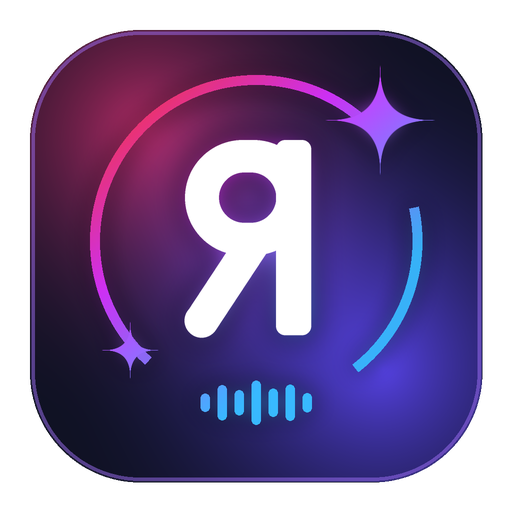
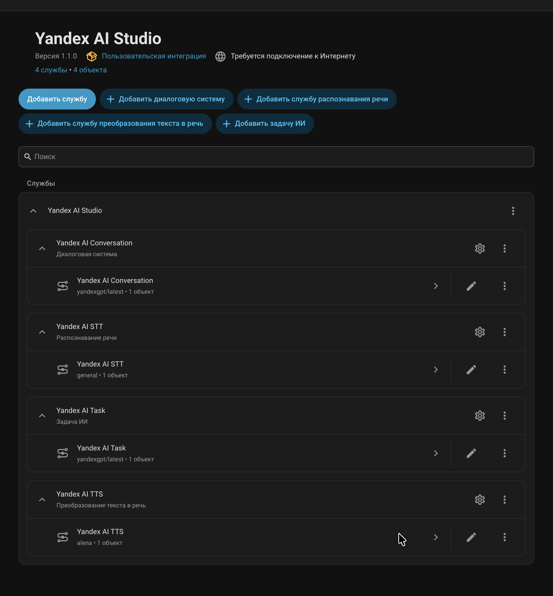
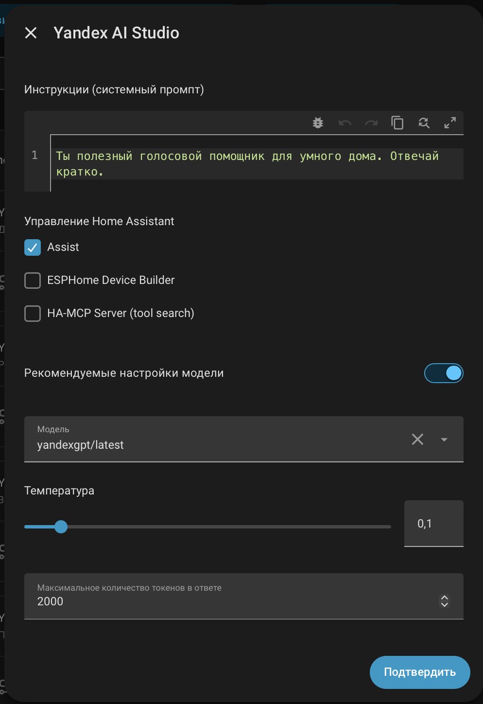
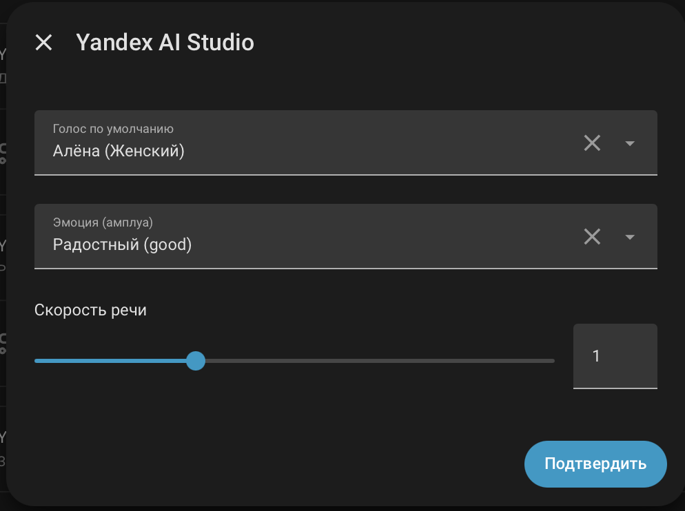
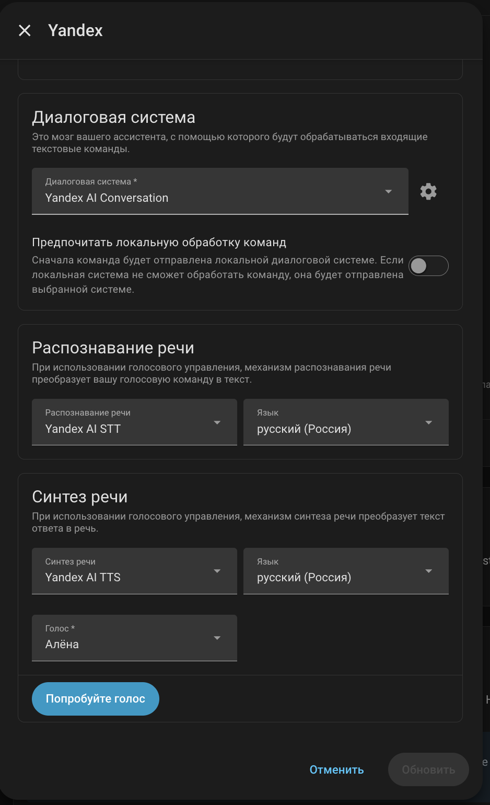
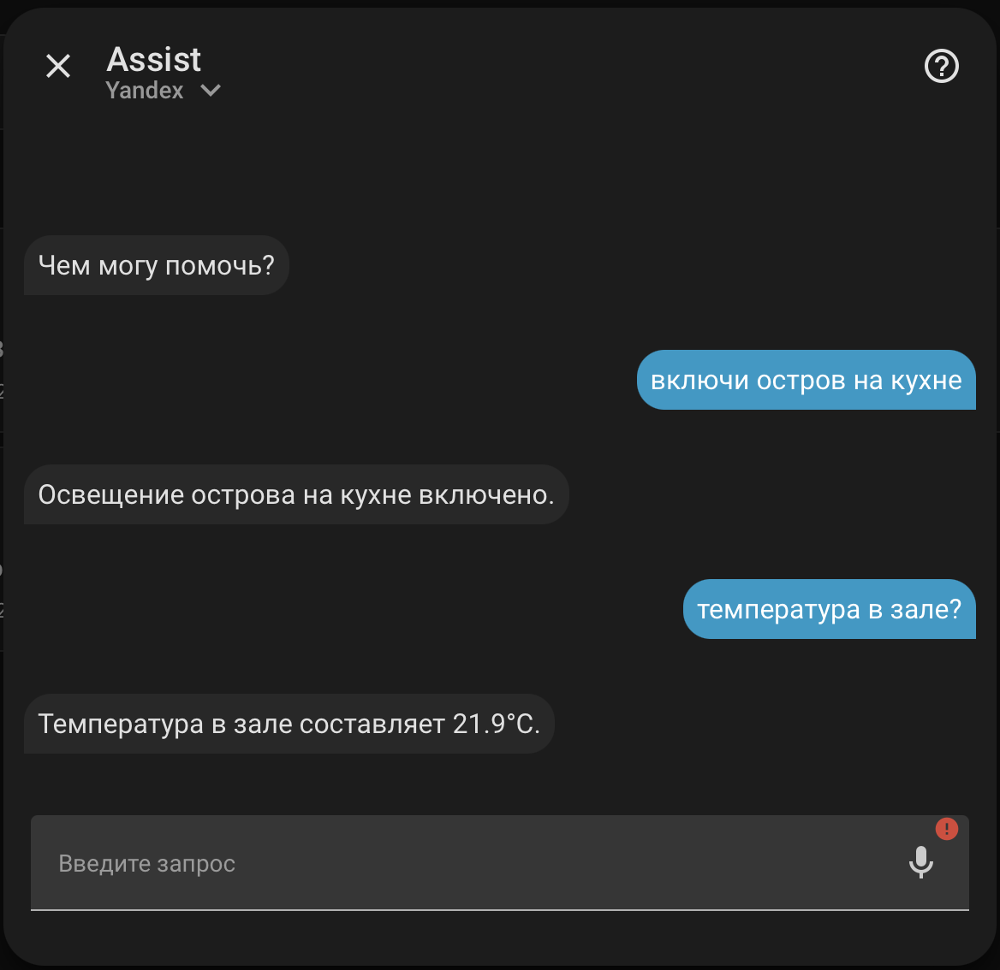

<p align="center">
  
</p>

<h1 align="center">Yandex AI Studio Integration for Home Assistant</h1>
<h2 align="center">Сделай свой умный дом по-настоящему умным с Яндекс!</h2>

<p align="center">
  <a href="https://github.com/hacs/integration"></a>
  <a href="https://opensource.org/licenses/MIT"></a>
  <a href="https://www.home-assistant.io/"></a>
</p>

Полнофункциональная интеграция **Yandex AI Studio (YandexGPT, YandexART и Yandex SpeechKit)** для **Home Assistant**, построенная по современной сервисной архитектуре `ConfigSubentry` и `ChatLog` (аналогично официальным интеграциям **Google Gemini** и **Ollama** в Home Assistant 2026).

Интеграция объединяет в одном подключении сразу **5 независимых ИИ-служб** для голосового ассистента **Assist** и автоматизаций умного дома:
1. 💬 **Диалоговая система (`Yandex AI Conversation`)** на базе **YandexGPT / AliceAI / Qwen3** с полноценным управлением умным домом (Tool Calling).
2. 🎙 **Распознавание речи (`Yandex AI STT`)** на базе **Yandex SpeechKit**.
3. 🔊 **Синтез речи (`Yandex AI TTS`)** на базе **Yandex SpeechKit** с выбором языка, голоса, эмоций (амплуа) и скорости речи.
4. 🧠 **Задача ИИ — текст, данные и Vision (`Yandex AI Task`)** — генерация текста, структурированных JSON-данных (**YandexGPT**) и мультимодальный анализ изображений/камер (**Gemma 3 27B Vision** — встроенный аналог `llmvision.image_analyzer`).
5. 🎨 **Задача ИИ — генерация изображений (`Yandex AI Task image`)** — создание изображений на базе **Alice AI ART (`aliceai-image-art-3.0`)**.

<p align="center">
  
</p>

---

## ✨ Главные возможности

* 🧩 **Современная модульная архитектура (`Subentries`):** Как в интеграциях *Google Gemini* и *Ollama*, каждая служба (`Conversation`, `STT`, `TTS`, `AI Task`) является отдельным сервисным устройством со своей кнопкой настроек ⚙️. Вы также можете добавлять несколько диалоговых агентов (например, один для голосовых колонок, второй для Telegram-бота, третий для отчётов).
* 🏠 **Полноценное управление Умным Домом (Native Tool Calling):** Агент использует нативный механизм `ChatLog` и `llm.ToolInput` Home Assistant. При вопросах вроде *«Какая температура в спальне?»* или командах *«Включи свет на кухне»* модель вызывает инструменты Home Assistant (`GetLiveContext`, `HassTurnOn` и др.), получает реальные данные датчиков и формирует естественный человеческий ответ.
* 🎭 **Выбор голоса и эмоций TTS прямо в Assist (SpeechKit API v1 + API v3):** Поддержка как классических голосов Yandex SpeechKit (*Алёна, Филипп, Эрмил, Джейн, Мадирус, Омаж, Захар*), так и новых голосов 3-го поколения (*Даша, Юлия, Лера, Маша, Марина, Александр, Кирилл, Антон*) со всеми их амплуа (*Радостный, Дружелюбный, Строгий, Шёпот, Нейтральный, Раздраженный*) прямо в выпадающем списке пайплайна **Assist**.
* 🖼 **Разделённые службы AI Task + Vision-анализ камер (как в Google Gemini):**
  * **`Yandex AI Task`** — генерация текста/JSON-данных (`ai_task.generate_data`) и **анализ готовых изображений и камер (`SUPPORT_ATTACHMENTS`)** через мультимодальную модель **`gemma-3-27b-it/latest`** (штатная замена `llmvision.image_analyzer`).
  * **`Yandex AI Task image`** — генерация картинок (`ai_task.generate_image`) через новую модель **Alice AI ART (`aliceai-image-art-3.0`)**.
* 📊 **Учёт токенов и расчётных затрат (`sensor.py`, Beta):** В карточке каждой службы автоматически создаются диагностические сенсоры потраченных токенов, озвученных символов, сгенерированных изображений и ориентировочных затрат в рублях (`RUB`). *Функция работает в тестовом режиме и может не совпадать с фактическими списаниями в биллинге.*
* 🔍 **Встроенная диагностика (`diagnostics.py`):** Поддержка выгрузки диагностических данных конфигурации с автоматическим скрытием API-ключей.

---

## 🔑 Получение Folder ID и API-ключа

Перед установкой и настройкой интеграции вам понадобятся **Folder ID** и **API Key** от Yandex Cloud / Yandex AI Studio.

👉 **[Подробная пошаговая инструкция: Как получить Folder ID и API-ключ (API_KEY_GUIDE.md)](API_KEY_GUIDE.md)**

---

## 📦 Установка

### Вариант 1: Через HACS (Рекомендуется)

[](https://my.home-assistant.io/redirect/hacs_repository/?owner=Eugen417&repository=HA-Yandex-generative_ai_conversation&category=integration)

1. Откройте **HACS** в вашем Home Assistant.
2. Нажмите на три точки в правом верхнем углу -> **Пользовательские репозитории** (*Custom repositories*).
3. Вставьте ссылку на этот репозиторий:
   `https://github.com/Eugen417/HA-Yandex-generative_ai_conversation`
4. Выберите категорию **Интеграция** (*Integration*) и нажмите **Добавить**.
5. Найдите **Yandex AI Studio** в списке HACS и нажмите **Скачать**.
6. **Перезагрузите Home Assistant**.

### Вариант 2: Ручная установка

1. Скачайте этот репозиторий (ZIP-архив).
2. Скопируйте папку `custom_components/yandex_generative_ai_conversation` в директорию `/config/custom_components/` вашего Home Assistant.
3. **Перезагрузите Home Assistant**.


---

## 🛠 Настройка в Home Assistant

### 1. Подключение интеграции
1. Перейдите в **Настройки -> Устройства и службы -> Добавить интеграцию**.
2. Введите в поиске **Yandex AI Studio**.
3. Укажите **Folder ID** и **API-ключ** (см. [инструкцию по их получению](API_KEY_GUIDE.md)).
4. После добавления интеграция автоматически создаст 5 базовых служб:
   - **Yandex AI Conversation** (Диалоговая система)
   - **Yandex AI STT** (Распознавание речи)
   - **Yandex AI TTS** (Преобразование текста в речь)
   - **Yandex AI Task** (Задача ИИ — текст, данные и Vision-анализ камер)
   - **Yandex AI Task image** (Задача ИИ — генерация изображений Alice AI ART)

При необходимости вы можете создавать дополнительные экземпляры любой из служб кнопками `+ Добавить диалоговую систему`, `+ Добавить службу распознавания речи`, `+ Добавить службу преобразования текста в речь`, `+ Добавить задачу ИИ (текст и данные)` и `+ Добавить задачу ИИ (генерация изображений)`.

---

### 2. Настройка диалоговой системы (`Yandex AI Conversation`)

Нажмите на значок шестерёнки ⚙️ напротив **Yandex AI Conversation**:
- **Инструкции (системный промпт):** Задайте характер и правила ответа ассистента.
- **Управление Home Assistant (`llm_hass_api`):** Выберите **Assist** (а также при желании дополнительные LLM API, например MCP Tools), чтобы разрешить модели управлять устройствами и читать их состояния.
- **Рекомендуемые настройки модели (`recommended`):** Когда переключатель включён (по умолчанию), поля выбора модели, температуры и токенов скрываются (как в Google Gemini), и автоматически используются оптимальные настройки (`yandexgpt/latest`, `temperature: 0.3`, `max_tokens: 2000`). При отключении переключателя открываются расширенные настройки:
- **Модель (`chat_model`):**
  - `yandexgpt/latest` — основная флагманская модель YandexGPT Pro (рекомендуется для голосового управления умным домом);
  - `yandexgpt-lite/latest` — быстрая и лёгкая модель для текстовых задач и AI Task;
  - `aliceai-llm/latest` — диалоговая модель Alice AI;
  - `gemma-3-27b-it/latest` — мультимодальная Vision-модель для анализа изображений и камер;
  - `qwen3-235b-a22b-fp8/latest` — модель Qwen3 235B в Yandex AI Studio;
  - `yandexgpt/rc` / `yandexgpt-lite/rc` — релиз-кандидаты новых версий (также поддерживается ввод любого собственного названия модели).
- **Температура и Max Tokens:** Тонкая настройка креативности и длины ответа.

<p align="center">
  
</p>

---

### 3. Настройка синтеза речи (`Yandex AI TTS`)

Нажмите на значок шестерёнки ⚙️ напротив **Yandex AI TTS**:
- **Голос по умолчанию:** Выберите предпочтительный голос (*Алёна, Филипп, Эрмил, Джейн, Захар, Марина, Даша, Юлия, Лера, Маша, Александр, Кирилл, Антон* и др.).
- **Эмоция (амплуа):** `Радостный (good)`, `Нейтральный (neutral)` или `Раздраженный (evil)`.
- **Скорость речи:** От `0.1` до `3.0` (по умолчанию `1.0`).

<p align="center">
  
</p>

#### Доступные голоса и эмоции для `ru-RU`:

| Голос | ID голоса | Пол | Поддерживаемые эмоции |
| :--- | :--- | :--- | :--- |
| **Алёна** | `alena` | Женский | `neutral`, `good` |
| **Филипп** | `filipp` | Мужской | `neutral` |
| **Эрмил** | `ermil` | Мужской | `neutral`, `good` |
| **Джейн** | `jane` | Женский | `neutral`, `good`, `evil` |
| **Омаж** | `omazh` | Женский | `neutral`, `evil` |
| **Захар** | `zahar` | Мужской | `neutral`, `good` |
| **Мадирус** | `madirus` | Мужской | `neutral` |
| **Даша / Юлия / Лера / Маша / Марина** | `dasha`, `julia`, `lera`, `masha`, `marina` | Женский | `neutral` |
| **Александр / Кирилл / Антон** | `alexander`, `kirill`, `anton` | Мужской | `neutral` |

*(Также поддерживаются языки `en-US` — `john`, `de-DE` — `lea`, `kk-KK` — `amira`, `madi`, `saule`, `zhanar`, `uz-UZ` — `nigora`, `lola`, `yulduz`, `he-IL` — `naomi`).*


---

### 4. Настройка голосового помощника (**Assist**)

1. Перейдите в **Настройки -> Голосовые помощники (Voice Assistants)**.
2. Создайте нового или откройте существующего ассистента (например, **Yandex**).
3. Выберите:
   - **Диалоговая система:** `Yandex AI Conversation`
   - *(Рекомендуется)* Включите переключатель **«Предпочитать локальную обработку команд»** — тогда простые типовые команды (*«включи/выключи свет»*) будут выполняться локально за 0 токенов, а сложные запросы пойдут в YandexGPT.
   - **Распознавание речи (STT):** `Yandex AI STT`
   - **Синтез речи (TTS):** `Yandex AI TTS` -> выберите язык `русский (Россия)` и нужный голос (или комбинацию `Голос (Эмоция)` прямо из выпадающего списка!).

<p align="center">
  
</p>

<p align="center">
  
</p>

---

## 📊 Учёт токенов и расчётных затрат (Beta / Тестовый режим)

В карточке каждой из 5 служб интеграции автоматически создаются диагностические сенсоры (на базе `RestoreSensor` с сохранением накопленных показаний при перезагрузке Home Assistant):
- **`Yandex AI Conversation` и `Yandex AI Task`**:
  - **Потрачено токенов (`tokens`)** — общее число токенов (в атрибутах сенсора доступны `input_tokens`, `output_tokens`, `last_request_tokens`, `requests_count`, `last_model`).
  - **Затраты (`RUB`)** — ориентировочная стоимость запросов в рублях.
- **`Yandex AI Task image`**:
  - **Сгенерировано изображений (`img`)** и **Затраты (`RUB`)**.
- **`Yandex AI TTS`**:
  - **Озвучено символов (`chars`)** и **Затраты (`RUB`)**.
- **`Yandex AI STT`**:
  - **Распознано запросов (`req`)** и **Затраты (`RUB`)**.

> ⚠️ **Обратите внимание:** Учёт затрат в рублях работает **в тестовом (ознакомительном) порядке** и **может не совпадать с реальными списаниями** в вашем личном кабинете Yandex Cloud Billing. Расчёт выполняется локально по базовым публичным тарифам за токен/запрос и не учитывает стартовый грант (Trial), индивидуальные скидки, округления биллинга или возможные изменения прайс-листа Яндекса.

---

## 🎨 Использование AI Task (Генерация картинок и данных)

Интеграция создаёт две отдельные специализированные службы (по аналогии с Google Gemini):
- **`Yandex AI Task`** (`ai_task.yandex_ai_task`) — для генерации текста и структурированных данных (`ai_task.generate_data`) через **YandexGPT**.
- **`Yandex AI Task image`** (`ai_task.yandex_ai_task_image`) — для генерации изображений (`ai_task.generate_image`) через **Alice AI ART (`aliceai-image-art-3.0`)**.

### Пример 1: Генерация изображения через Alice AI ART (`ai_task.generate_image`)

```yaml
action: ai_task.generate_image
data:
  entity_id: ai_task.yandex_ai_task_image
  task_name: "Погода на сегодня"
  instructions: "Уютный умный дом в осеннем лесу, мягкий тёплый свет в окнах, кинематографичный стиль"
response_variable: generated_image
```

### Пример 2: Генерация структурированных данных через YandexGPT (`ai_task.generate_data`)

```yaml
action: ai_task.generate_data
data:
  entity_id: ai_task.yandex_ai_task
  task_name: "Краткая сводка по дому"
  instructions: "Составь краткую сводку для утреннего приветствия на основе погоды и температуры в спальне."
response_variable: summary
```

### Пример 3: Анализ камер и изображений (Vision — аналог `llmvision.image_analyzer`)

Служба `Yandex AI Task` поддерживает флаг `SUPPORT_ATTACHMENTS` (прикрепление камер и изображений) и автоматически анализирует их через мультимодальную Vision-модель Яндекса **`gemma-3-27b-it/latest`**:

```yaml
action: ai_task.generate_data
data:
  entity_id: ai_task.yandex_ai_task
  task_name: "Анализ камеры у входа"
  instructions: "Опиши на русском языке, что происходит на камере. Есть ли люди или машины?"
  attachments:
    - media_content_id: media-source://camera/camera.vkhodnaia_dver
      media_content_type: image/jpeg
response_variable: camera_analysis
```

---

## 📂 Структура репозитория

```text
HA-Yandex-generative_ai_conversation/
├── .github/workflows/          # GitHub Actions (Hassfest & HACS Validation, Release)
├── custom_components/
│   └── yandex_generative_ai_conversation/
│       ├── __init__.py         # Инициализация интеграции и управление Subentries
│       ├── ai_task.py          # Платформа AI Task (YandexGPT + YandexART)
│       ├── brand/              # Локальные иконки и логотипы интеграции (icon.png, logo.png)
│       ├── config_flow.py      # Мастер настройки и ConfigSubentryFlow
│       ├── const.py            # Константы, модели и список голосов/эмоций
│       ├── conversation.py     # Диалоговый агент для Assist
│       ├── diagnostics.py      # Диагностика интеграции с маскированием ключей
│       ├── entity.py           # Базовый класс LLM и цикл Tool Calling через ChatLog
│       ├── manifest.json       # Манифест интеграции
│       ├── sensor.py           # Сенсоры учёта токенов, запросов и расчётных затрат (RUB)
│       ├── strings.json        # Строки локализации
│       ├── stt.py              # Распознавание речи (Yandex SpeechKit STT)
│       ├── tts.py              # Синтез речи (Yandex SpeechKit TTS v1 + v3)
│       └── translations/       # Переводы (ru.json, en.json)
├── images/                     # Папка для скриншотов документации
├── API_KEY_GUIDE.md            # Пошаговая инструкция по получению Folder ID и API-ключа
├── CHANGELOG.md                # История изменений
├── LICENSE                     # Лицензия MIT
├── README.md                   # Основная документация
└── hacs.json                   # Конфигурация HACS
```

---

## 📄 Лицензия

Этот проект распространяется под лицензией **MIT License**. Подробности в файле [LICENSE](LICENSE).

