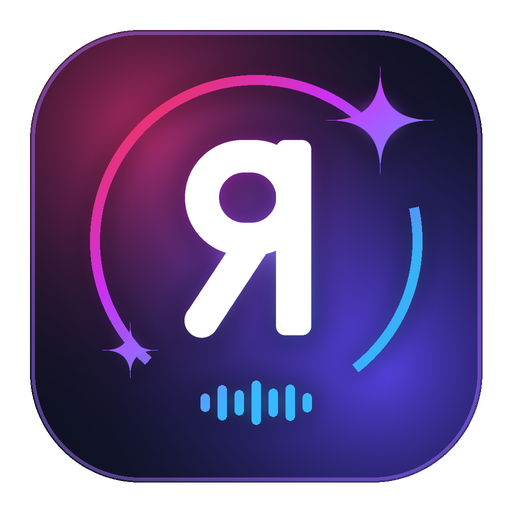
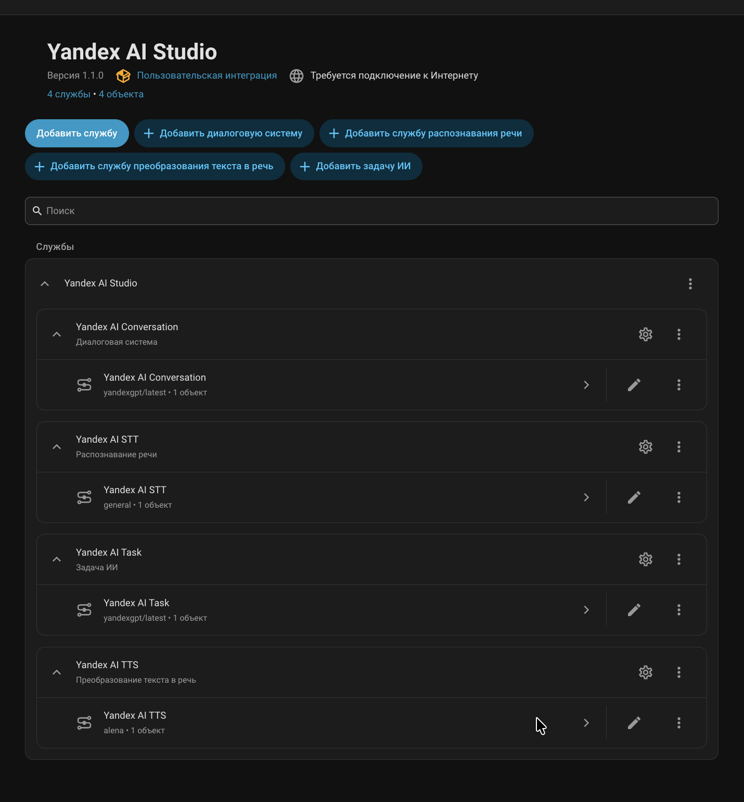
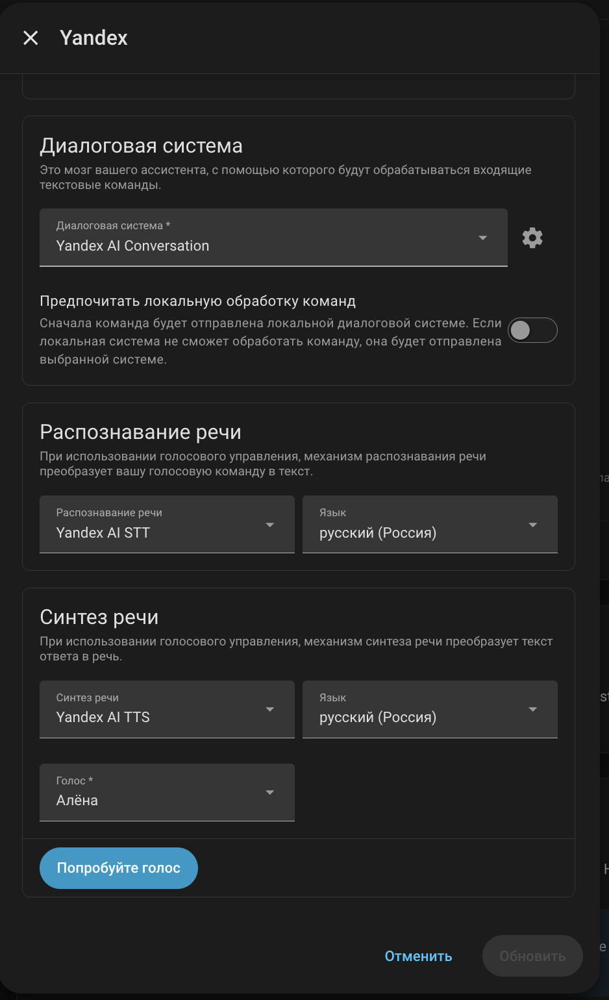
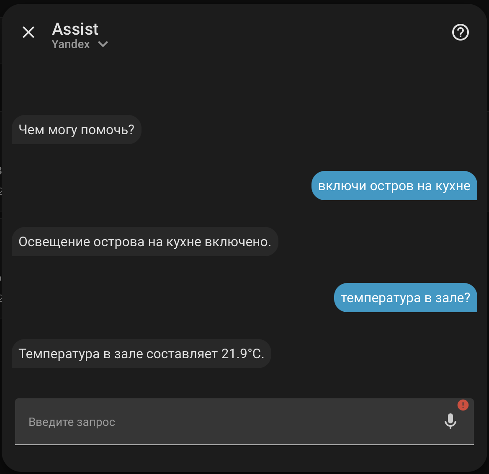
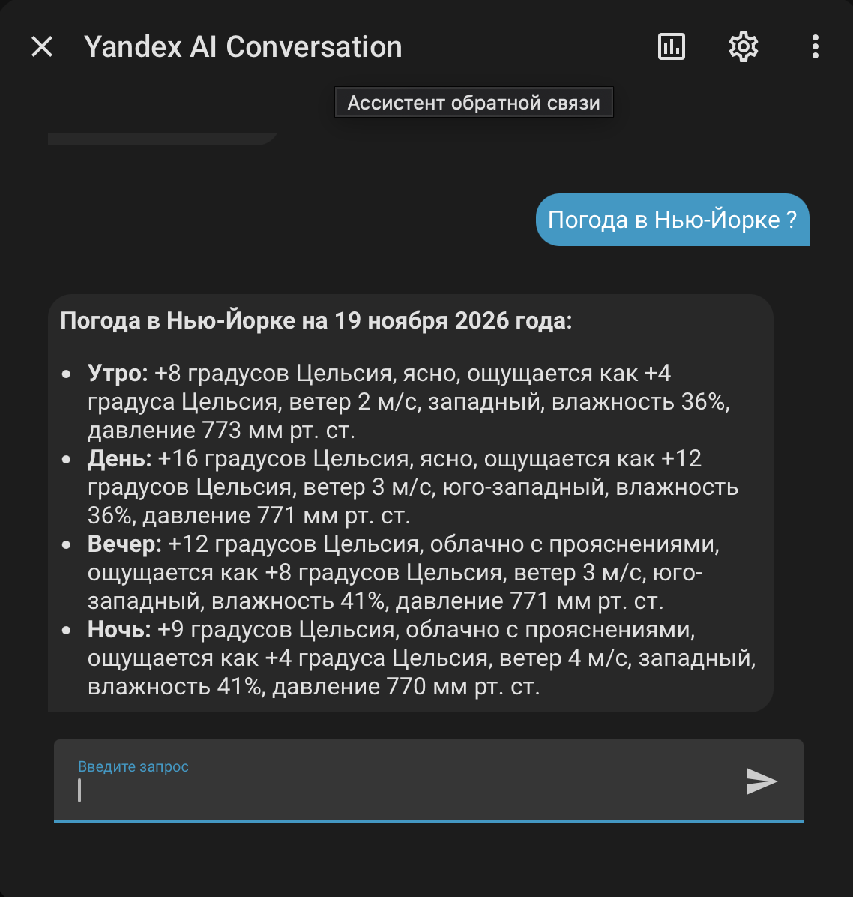
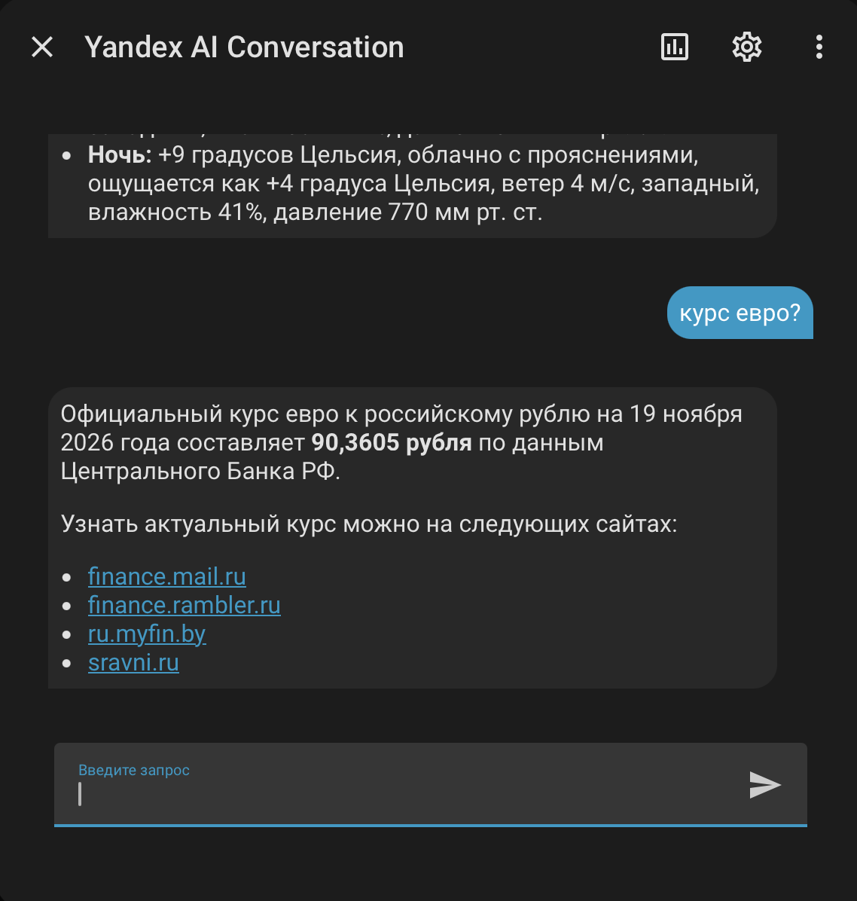

<p align="center">
  
</p>

<h1 align="center">Yandex AI Studio Integration for Home Assistant</h1>
<h2 align="center">Сделай свой умный дом по-настоящему умным с Яндекс!</h2>

<p align="center">
  <a href="https://github.com/hacs/integration"></a>
  <a href="https://github.com/Eugen417/HA-Yandex-generative_ai_conversation/releases"></a>
  <a href="https://github.com/Eugen417/HA-Yandex-generative_ai_conversation/releases"></a>
  <a href="https://www.home-assistant.io/"></a>
  <a href="https://opensource.org/licenses/MIT"></a>
</p>

<p align="center">
  <b>🇷🇺 Русский</b> | <a href="README.en.md">🇬🇧 English</a>
</p>

Полнофункциональная интеграция **Yandex AI Studio (YandexGPT, YandexART и Yandex SpeechKit)** для **Home Assistant**, построенная по современной сервисной архитектуре `ConfigSubentry` и `ChatLog` (аналогично официальным интеграциям **Google Gemini** и **Ollama** и пользовательской [**Sber GigaChat AI**](https://github.com/Eugen417/HA-GigaChat-generative_ai_conversation)). Совместима с **Home Assistant 2025.8+ и 2026.x**.

Интеграция объединяет в одном подключении сразу **5 независимых ИИ-служб** для голосового ассистента **Assist** и автоматизаций умного дома:
1. 💬 **Диалоговая система (`Yandex AI Conversation`)** на базе **YandexGPT Pro 5.1 / Alice AI LLM (Flash) / DeepSeek V4.1 Flash (1M) / Qwen3.6 35B** с полноценным управлением умным домом (Tool Calling), потоковым ответом и подключаемым Поиском Яндекса.
2. 🎙 **Распознавание речи (`Yandex AI STT`)** на базе **Yandex SpeechKit**.
3. 🔊 **Синтез речи (`Yandex AI TTS`)** на базе **Yandex SpeechKit (v1, v3 и LiveTTS 4-го поколения)** со сквозным потоковым синтезом по предложениям.
4. 🧠 **Задача ИИ — текст, данные и Vision (`Yandex AI Task`)** — генерация текста, структурированных JSON-данных и мультимодальный анализ изображений/камер (**Qwen3.6 35B Vision** — встроенный аналог `llmvision.image_analyzer`).
5. 🎨 **Задача ИИ — генерация изображений (`Yandex AI Task image`)** — создание изображений на базе **Alice AI ART (`aliceai-image-art-3.0`)**.

<p align="center">
  
</p>

---

## ✨ Главные возможности

* 🧩 **Современная модульная архитектура (`Subentries`):** Как в интеграциях *Google Gemini* и *Ollama*, каждая служба (`Conversation`, `STT`, `TTS`, `AI Task`) является отдельным сервисным устройством со своей кнопкой настроек ⚙️. Вы также можете добавлять несколько диалоговых агентов (например, один для голосовых колонок, второй для Telegram-бота, третий для отчётов).
* 🏠 **Полноценное управление Умным Домом (Native Tool Calling):** Агент использует нативный механизм `ChatLog` и `llm.ToolInput` Home Assistant. При вопросах вроде *«Какая температура в спальне?»* или командах *«Включи свет на кухне»* модель вызывает инструменты Home Assistant (`GetLiveContext`, `HassTurnOn` и др.), получает реальные данные датчиков и формирует естественный человеческий ответ.
* 🎭 **Выбор голоса и эмоций TTS прямо в Assist (SpeechKit API v1 + API v3):** Поддержка как классических голосов Yandex SpeechKit (*Алёна, Филипп, Эрмил, Джейн, Мадирус, Омаж, Захар*), так и новых голосов 3-го поколения (*Даша, Юлия, Лера, Маша, Марина, Александр, Кирилл, Антон*) со всеми их амплуа (*Радостный, Дружелюбный, Строгий, Шёпот, Нейтральный, Раздраженный*) прямо в выпадающем списке пайплайна **Assist**.
* 🖼 **Разделённые службы AI Task + Vision-анализ камер (как в Google Gemini):**
  * **`Yandex AI Task`** — генерация текста/JSON-данных (`ai_task.generate_data`) и **анализ готовых изображений и камер (`SUPPORT_ATTACHMENTS`)** через мультимодальную модель **`qwen3.6-35b-a3b`** (`256k` контекст, штатная замена `llmvision.image_analyzer`).
  * **`Yandex AI Task image`** — генерация картинок (`ai_task.generate_image`) через новую модель **Alice AI ART (`aliceai-image-art-3.0`)**.
* 📊 **Учёт токенов и расчётных затрат (`sensor.py`, Beta):** В карточке каждой службы автоматически создаются диагностические сенсоры потраченных токенов, озвученных символов, сгенерированных изображений и ориентировочных затрат в рублях (`RUB`). *Функция работает в тестовом режиме и может не совпадать с фактическими списаниями в биллинге.*
* 🔍 **Встроенная диагностика (`diagnostics.py`):** Поддержка выгрузки диагностических данных конфигурации с автоматическим скрытием API-ключей.

---

## 🔑 Получение Folder ID и API-ключа

Перед установкой и настройкой интеграции вам понадобятся **Folder ID** и **API Key** от Yandex Cloud / Yandex AI Studio.

👉 **[Подробная пошаговая инструкция: Как получить Folder ID и API-ключ (API_KEY_GUIDE.md)](API_KEY_GUIDE.md)**

---

## 📦 Установка

### Вариант 1: Через HACS / Marketplace (Рекомендуется)

[](https://my.home-assistant.io/redirect/hacs_repository/?owner=Eugen417&repository=HA-Yandex-generative_ai_conversation&category=integration)

1. Нажмите кнопку выше или откройте **HACS / Marketplace** в вашем Home Assistant.
2. Найдите в поиске **Yandex AI Studio**, нажмите **Скачать** и **перезагрузите Home Assistant**.

### Вариант 2: Ручная установка

1. Скачайте этот репозиторий (ZIP-архив).
2. Скопируйте папку `custom_components/yandex_generative_ai_conversation` в директорию `/config/custom_components/` вашего Home Assistant.
3. **Перезагрузите Home Assistant**.


---

## 🛠 Настройка в Home Assistant

### 1. Подключение интеграции
1. Перейдите в **Настройки -> Устройства и службы -> Добавить интеграцию**.
2. Введите в поиске **Yandex AI Studio**.
3. Укажите **Folder ID** и **API-ключ** (см. [инструкцию по их получению](API_KEY_GUIDE.md)).
4. После добавления интеграция автоматически создаст 5 базовых служб:
   - **Yandex AI Conversation** (Диалоговая система)
   - **Yandex AI STT** (Распознавание речи)
   - **Yandex AI TTS** (Преобразование текста в речь)
   - **Yandex AI Task** (Задача ИИ — текст, данные и Vision-анализ камер)
   - **Yandex AI Task image** (Задача ИИ — генерация изображений Alice AI ART)

При необходимости вы можете создавать дополнительные экземпляры любой из служб кнопками `+ Добавить диалоговую систему`, `+ Добавить службу распознавания речи`, `+ Добавить службу преобразования текста в речь`, `+ Добавить задачу ИИ (текст и данные)` и `+ Добавить задачу ИИ (генерация изображений)`.

---

### 2. Настройка диалоговой системы (`Yandex AI Conversation`)

Нажмите на значок шестерёнки ⚙️ напротив **Yandex AI Conversation**:
- **Инструкции (системный промпт):** Задайте характер и правила ответа ассистента.
- **AI tools (`llm_hass_api`):** Выберите **`Device control` (`Assist`)** (и при желании публичные MCP-серверы, например `HA-MCP Server`), чтобы разрешить модели управлять устройствами и читать их состояния.
  - ⚠️ **Важно про права `Home Assistant` и голосовые колонки:** системный пункт **`Home Assistant`** в списке `AI tools` даёт полный админский доступ ко всей системе и по правилам безопасности ядра Home Assistant (так же, как в *Google Gemini* и *Ollama*) работает **только у авторизованных администраторов в браузере или мобильном приложении**. На физических голосовых колонках и спутниках (*`ESP32-S3-Box-3`, `Home Assistant Voice PE`, `M5Stack Atom Echo`, `Wyoming`*) отсутствует админский `user_id`, поэтому при отмеченной галочке **`Home Assistant`** ядро HA отклонит запрос колонки с ошибкой `Error getting LLM API ...: Unauthorized`. Для голосовых колонок оставляйте галочку **`Home Assistant` снятой** (используйте `Device control`), а если нужен админский агент для браузера — добавьте второго агента кнопкой `+ Добавить диалоговую систему`.
  - Если вы создаёте отдельного чистого чат-бота для ВКонтакте или Telegram без доступа к управлению домом — просто очистите поле `AI tools`.
- **Поиск в интернете — текст (`web_search`, по умолчанию Выкл):** Подключаемый инструмент **Yandex Search** (`GenSearch API v2`). Оставляйте **выключенным** у голосового агента управления домом и **включайте** у второго агента для мессенджеров (ВК / Telegram) для вопросов о погоде, курсах и новостях.
- **Поиск по картинке — Умная камера (`image_search`, по умолчанию Выкл):** Независимый переключатель обратного поиска по присланному фото в **Яндекс Картинках (`CBIR`)**. Если он **выключен**, присланные в чат фото анализируются только глазами модели **`Qwen3.6 35B Vision`** (чтение счётчиков, чеков, документов) без отправки фото в поисковик.
- **Потоковый ответ (`streaming`, по умолчанию Вкл):** Передача текста по частям (SSE) в реальном времени — голосовой помощник Assist начинает озвучивать ответ с первых слов, не дожидаясь генерации всего текста.
- **Рекомендуемые настройки модели (`recommended`):** Когда переключатель включён (по умолчанию), используются оптимальные параметры (`yandexgpt-5.1`, `temperature: 0.3`, `max_tokens: 2000`). При отключении открываются расширенные настройки (со списком моделей, автоматически дополняемым из `/v1/models`):
  - **Модель (`chat_model`) — актуальные модели базового инстанса (вх. / исх. за 1K токенов с НДС):**
    - `yandexgpt-5.1` — **YandexGPT Pro 5.1** (`0.80 / 0.80 ₽`, 32k — флагман для управления УД);
    - `aliceai-llm-flash` — **Alice AI LLM Flash** (`0.10 / 0.20 ₽`, 64k — сверхбыстрая и дешёвая разговорная модель для колонок и мессенджеров);
    - `aliceai-llm` — **Alice AI LLM** (`0.50 / 1.20 ₽`, 128k — живая диалоговая модель);
    - `deepseek-v4.1-flash` — **DeepSeek V4.1 Flash** (`0.30 / 0.50 ₽`, **1M контекст** — идеальна для сложных ИИ-агентов и MCP);
    - `qwen3.6-35b-a3b` — **Qwen3.6 35B Vision** (`0.20 / 0.30 ₽`, 256k — анализ камер, фото и многошаговая логика);
    - `yandexgpt-5-pro` — **YandexGPT Pro 5** (`1.20 / 1.20 ₽`, 32k), а также поддержка legacy-URI и любых пользовательских моделей.
  - **Режим рассуждений (`reasoning_effort`):** `none` (выключен), `low`, `medium`, `high` — глубина предварительных рассуждений для `Qwen3.6`, `DeepSeek V4.1` и `Alice AI LLM`.
  - **Температура и Max Tokens:** Тонкая настройка креативности и длины ответа.

<p align="center">
  
</p>

#### 💡 Для чего нужны Streaming, Поиск в интернете и Reasoning — и как они влияют на расход токенов?

| Опция | Для чего нужна и где полезна | Влияние на расход токенов и стоимость | Рекомендация |
| :--- | :--- | :--- | :--- |
| **Потоковый ответ (`SSE Streaming`)** | Передаёт слова по мере генерации, не дожидаясь конца абзаца. В голосовых колонках и спутниках **Assist** озвучка (`TTS`) стартует через **0.5–1 с** вместо 4–8 с тишины. Для ботов мессенджеров (`conversation.process`) разницы нет, так как ответ отправляется одним сообщением. | **0 ₽ / +0 токенов.** В биллинге Яндекса тарифицируется ровно то же число токенов, что и без стриминга. *(Техническая деталь: если выбранная модель не присылает финальный блок `usage` в SSE-потоке, сенсор в HA оценивает токены расчётно по длине текста; при `Выкл` всегда приходит точное число от сервера).* | Держать **Вкл** для голосового Assist. |
| **Поиск в интернете (`Yandex Search`)** | Позволяет модели самой запрашивать в Яндексе актуальную погоду, курсы валют ЦБ, новости, цены и расписания с возвратом кликабельных ссылок на источники (`sources`). | **В пассивном режиме** (когда поиск включён, но вопрос бытовой и модель его не вызывает): всего **~100 входных токенов** за описание инструмента.<br>**При срабатывании поиска:**<br>1) оплачивается вызов веб-поиска (**0.915 ₽** / запрос по прайсу AI Studio);<br>2) выполняется **второй проход к LLM**, куда передаётся найденная выдача (+500…2000 токенов) **и повторно весь системный промпт со списком устройств дома**! | **Выкл** на агенте управления домом (чтобы не гонять дважды огромный список лампочек и датчиков). **Вкл** на отдельном втором агенте для чата **ВК / Telegram** с очищенным полем `AI tools` (например, на быстрой `aliceai-llm-flash`). |
| **Поиск по картинке (`Yandex Images`)** | Обратный поиск по присланному фото в базе Яндекс Картинок (`CBIR` — определение точных моделей товаров, растений, деталей со ссылками на магазины). Работает **независимо** от текстового поиска. | **Когда Выкл:** присланные фото смотрит только `Qwen3.6 Vision` (0 ₽ за поиск).<br>**При срабатывании:** **0.915 ₽** за поиск по картинке + 2-й проход к LLM с найденными карточками сайтов. | Держать **Выкл**, если шлёте боту только чеки/счётчики; включать на боте ВК/Telegram, если нужна функция «Умной камеры». |
| **Режим рассуждений (`Reasoning`)** | Включает скрытую цепочку размышлений (`low` / `medium` / `high`) перед ответом у `Qwen3.6`, `DeepSeek V4.1` и `Alice AI LLM`. Повышает точность в сложных логических задачах и аналитике. | **Увеличивает расход в 2–5 раз.** Скрытые рассуждения (`reasoning_content`) не произносятся вслух, но тарифицируются Яндексом как полноценные выходные токены (`completion_tokens`), плюс замедляют первый ответ. | Держать **`none` (Выкл)** для обычного общения и голосовых команд; включать точечно для сложных задач `AI Task` / аналитики. |

---

### 3. Настройка синтеза речи (`Yandex AI TTS`)

Нажмите на значок шестерёнки ⚙️ напротив **Yandex AI TTS**:
- **Голос по умолчанию:** Выберите предпочтительный голос (*Алёна, Филипп, Эрмил, Джейн, Захар, Марина, Даша, Юлия, Лера, Маша, Александр, Кирилл, Антон* и др.).
- **Эмоция (амплуа):** `Радостный (good)`, `Нейтральный (neutral)` или `Раздраженный (evil)`.
- **Скорость речи:** От `0.1` до `3.0` (по умолчанию `1.0`).

<p align="center">
  
</p>

#### Доступные голоса и амплуа для `ru-RU` (SpeechKit v1 / v3 / LiveTTS):

| Голос | ID голоса | Пол | Поколение / Модель | Поддерживаемые амплуа (`role`) |
| :--- | :--- | :--- | :--- | :--- |
| **Ирина** | `irina` | Женский | **LiveTTS (v3)** | `neutral` *(по умолч.)*, `narrator`, `formal`, `support`, `sales` |
| **Софья / Вера** | `sofia`, `vera` | Женский | **LiveTTS (v3)** | `support` *(по умолч.)*, `casual` |
| **Денис** | `denis` | Мужской | **LiveTTS (v3)** | `neutral` *(по умолч.)*, `casual`, `formal`, `sales` |
| **Василий / Сергей** | `vasily`, `sergey` | Мужской | **LiveTTS (v3)** | `support` *(по умолч.)*, `sales` |
| **Даша / Юлия / Лера / Маша / Марина** | `dasha`, `julia`, `lera`, `masha`, `marina` | Женский | SpeechKit v3 | `neutral`, `good`, `friendly`, `strict`, `whisper` *(по голосу)* |
| **Александр / Кирилл / Антон** | `alexander`, `kirill`, `anton` | Мужской | SpeechKit v3 | `neutral`, `good`, `strict` *(по голосу)* |
| **Замира RU / Жанар RU / Сауле RU / Юлдуз RU / Мади RU** | `zamira_ru`, `zhanar_ru`, `saule_ru`, `yulduz_ru`, `madi_ru` | Ж / М | SpeechKit v3 | `neutral`, `friendly`, `strict`, `whisper` |
| **Алёна / Филипп / Эрмил / Джейн / Омаж / Захар / Мадирус** | `alena`, `filipp`, `ermil`, `jane`, `omazh`, `zahar`, `madirus` | Ж / М | SpeechKit v1 | `neutral`, `good`, `evil` *(по голосу)* |

*(Также поддерживаются языки `en-US` — `john`, `de-DE` — `lea`, `kk-KK` — `amira`, `madi`, `saule`, `zhanar`, `uz-UZ` — `nigora`, `zamira`, `lola`, `yulduz`, `he-IL` — `naomi` (`modern`, `classic`). Для голосов `LiveTTS` скорость и сдвиг высоты тона управляются нейросетью, а тариф синтеза составляет `0.05 ₽/сек` против `0.0203 ₽/сек` у базовых голосов).*


---

### 4. Настройка голосового помощника (**Assist**)

1. Перейдите в **Настройки -> Голосовые помощники (Voice Assistants)**.
2. Создайте нового или откройте существующего ассистента (например, **Yandex**).
3. Выберите:
   - **Диалоговая система:** `Yandex AI Conversation`
   - *(Рекомендуется)* Включите переключатель **«Предпочитать локальную обработку команд»** — тогда простые типовые команды (*«включи/выключи свет»*) будут выполняться локально за 0 токенов, а сложные запросы пойдут в YandexGPT.
   - **Распознавание речи (STT):** `Yandex AI STT`
   - **Синтез речи (TTS):** `Yandex AI TTS` -> выберите язык `русский (Россия)` и нужный голос (или комбинацию `Голос (Эмоция)` прямо из выпадающего списка!). Поддерживается **сквозной потоковый синтез речи по предложениям (`async_stream_tts_audio`)** в бесшовный `WAV PCM` как для голосов v3, так и для классических голосов v1 — колонка начинает говорить первое предложение сразу по мере генерации текста моделью.

> ⚠️ **Напоминание для владельцев голосовых колонок (`ESP32-S3-Box-3`, `Home Assistant Voice PE`, `Atom Echo`, `Wyoming`):** убедитесь, что в настройках выбранного агента `Yandex AI Conversation` в поле **`AI tools`** отмечен **`Device control`**, но **снята** админская галочка **`Home Assistant`** — иначе ядро Home Assistant заблокирует голосовой запрос от устройства с ошибкой `Unauthorized`.

<p align="center">
  
</p>

<p align="center">
  
</p>

---

## 📊 Учёт токенов и расчётных затрат (Beta / Тестовый режим)

В карточке каждой из 5 служб интеграции автоматически создаются диагностические сенсоры (на базе `RestoreSensor` с сохранением накопленных показаний при перезагрузке Home Assistant):
- **`Yandex AI Conversation` и `Yandex AI Task`**:
  - **Потрачено токенов (`tokens`)** — общее число токенов (в атрибутах сенсора доступны `input_tokens`, `output_tokens`, `last_request_tokens`, `requests_count`, `last_model`).
  - **Затраты (`RUB`)** — ориентировочная стоимость запросов в рублях.
- **`Yandex AI Task image`**:
  - **Сгенерировано изображений (`img`)** и **Затраты (`RUB`)**.
- **`Yandex AI TTS`**:
  - **Озвучено символов (`chars`)** и **Затраты (`RUB`)**.
- **`Yandex AI STT`**:
  - **Распознано запросов (`req`)** и **Затраты (`RUB`)**.

> ⚠️ **Обратите внимание:** Учёт затрат в рублях работает **в тестовом (ознакомительном) порядке** и **может не совпадать с реальными списаниями** в вашем личном кабинете Yandex Cloud Billing. Расчёт выполняется локально по базовым публичным тарифам за токен/запрос и не учитывает стартовый грант (Trial), индивидуальные скидки, округления биллинга или возможные изменения прайс-листа Яндекса.

---

## 🎨 Использование AI Task (Генерация картинок и данных)

Интеграция создаёт две отдельные специализированные службы (по аналогии с Google Gemini):
- **`Yandex AI Task`** (`ai_task.yandex_ai_task`) — для генерации текста и структурированных данных (`ai_task.generate_data`) через **YandexGPT**.
- **`Yandex AI Task image`** (`ai_task.yandex_ai_task_image`) — для генерации изображений (`ai_task.generate_image`) через **Alice AI ART (`aliceai-image-art-3.0`)**.

### Пример 1: Генерация изображения через Alice AI ART (`ai_task.generate_image`)

```yaml
action: ai_task.generate_image
data:
  entity_id: ai_task.yandex_ai_task_image
  task_name: "Погода на сегодня"
  instructions: "Уютный умный дом в осеннем лесу, мягкий тёплый свет в окнах, кинематографичный стиль"
response_variable: generated_image
```

### Пример 2: Генерация структурированных данных через YandexGPT (`ai_task.generate_data`)

```yaml
action: ai_task.generate_data
data:
  entity_id: ai_task.yandex_ai_task
  task_name: "Краткая сводка по дому"
  instructions: "Составь краткую сводку для утреннего приветствия на основе погоды и температуры в спальне."
response_variable: summary
```

### Пример 3: Анализ камер и изображений (Vision — аналог `llmvision.image_analyzer`)

Служба `Yandex AI Task` поддерживает флаг `SUPPORT_ATTACHMENTS` (прикрепление камер и изображений) и автоматически анализирует их через мультимодальную Vision-модель **`qwen3.6-35b-a3b`**:

```yaml
action: ai_task.generate_data
data:
  entity_id: ai_task.yandex_ai_task
  task_name: "Анализ камеры у входа"
  instructions: "Опиши на русском языке, что происходит на камере. Есть ли люди или машины?"
  attachments:
    - media_content_id: media-source://camera/camera.vkhodnaia_dver
      media_content_type: image/jpeg
response_variable: camera_analysis
```

---

## 💬 Примеры автоматизаций: Чат-боты ВКонтакте и Telegram (с Поиском Яндекса)

Благодаря модульной архитектуре `Subentries` лучше всего разделить роли между двумя диалоговыми агентами в карточке интеграции **Yandex AI Studio**:
1. **`Yandex AI Conversation`** (для голосовых колонок и Assist): `AI tools = Assist`, **`Поиск в интернете = Выкл`** — мгновенное управление светом, климатом и датчиками без лишних задержек.
2. Нажмите **`+ Добавить диалоговую систему`**, назовите её **`Yandex Бот Чата`** (`conversation.yandex_bot_chata`): очистите `AI tools` (или оставьте нужные), включите **`Поиск в интернете (Yandex Search) = Вкл`** и выберите модель (например, живую `aliceai-llm/latest`, мощную `qwen3-235b-a22b-fp8/latest` или экономичную `yandexgpt-lite/latest`). *(Не забудьте выдать сервисному аккаунту роль `search-api.webSearch.user` — см. [API_KEY_GUIDE.md](API_KEY_GUIDE.md)).*

<p align="center">
  
  
</p>

Все готовые к копированию YAML-конфигурации вынесены в отдельную папку **[`examples/`](examples/)**:

| Готовый файл | Описание сценария |
| :--- | :--- |
| 📄 **[`examples/vk_chatbot.yaml`](examples/vk_chatbot.yaml)** | **Умный чат-бот ВКонтакте** ([VK Notify](https://github.com/Eugen417/ha_vk_notify_plus)): живой диалог в ЛС + активация по имени `Бот190` в групповой беседе, белый список `from_id`, поддержка текста, голосовых (`transcript`) и фотографий (`[image: <url>]`). |
| 📄 **[`examples/vk_camera_vision.yaml`](examples/vk_camera_vision.yaml)** | **Команда `/камера` во ВКонтакте**: снимок с камеры Home Assistant + описание обстановки от `Qwen3.6 35B Vision`. |
| 📄 **[`examples/telegram_chatbot.yaml`](examples/telegram_chatbot.yaml)** | **Умный чат-бот Telegram** (`telegram_bot`, схема HA 2026+): живой диалог в ЛС + по имени `Бот190` в группе, приём текста и фото (`telegram_bot.download_file`), индикатор `typing` и цитирование. |
| 📄 **[`examples/ai_task_examples.yaml`](examples/ai_task_examples.yaml)** | Готовые шаблоны вызовов `ai_task.generate_image` (*Alice AI ART*) и `ai_task.generate_data` (сводки и анализ камер). |
| 📖 **[`examples/README.md`](examples/README.md)** | Подробная инструкция по настройке `from_id` / `user_id` и разграничению режимов обработки фото (только локальный осмотр `Qwen3.6 Vision` vs `Поиск по картинке`). |

---

## 📂 Структура репозитория

```text
HA-Yandex-generative_ai_conversation/
├── .github/workflows/          # GitHub Actions (Hassfest & HACS Validation, Release)
├── custom_components/
│   └── yandex_generative_ai_conversation/
│       ├── __init__.py         # Инициализация интеграции и управление Subentries
│       ├── ai_task.py          # Платформа AI Task (YandexGPT + Vision + Alice AI ART)
│       ├── brand/              # Локальные иконки и логотипы интеграции (icon.png, logo.png)
│       ├── config_flow.py      # Мастер настройки и ConfigSubentryFlow
│       ├── const.py            # Константы, модели, тарифы и список голосов/амплуа
│       ├── conversation.py     # Диалоговый агент для Assist
│       ├── diagnostics.py      # Диагностика интеграции с маскированием ключей
│       ├── entity.py           # Базовый класс LLM, SSE-стриминг, Vision и Tool Calling
│       ├── helpers.py          # Авторизация (Api-Key/IAM), /v1/models, Web & Image Search
│       ├── manifest.json       # Манифест интеграции
│       ├── sensor.py           # Сенсоры учёта токенов, запросов и расчётных затрат (RUB)
│       ├── strings.json        # Строки локализации
│       ├── stt.py              # Распознавание речи (Yandex SpeechKit STT)
│       ├── tts.py              # Потоковый синтез речи (SpeechKit TTS v1, v3 и LiveTTS)
│       └── translations/       # Переводы (ru.json, en.json)
├── examples/                   # Готовые YAML-автоматизации для ВКонтакте, Telegram и AI Task
├── images/                     # Папка для скриншотов документации
├── API_KEY_GUIDE.md            # Пошаговая инструкция по получению Folder ID и API-ключа
├── CHANGELOG.md                # История изменений
├── LICENSE                     # Лицензия MIT
├── README.en.md                # Документация на английском языке (English documentation)
├── README.md                   # Основная документация
└── hacs.json                   # Конфигурация HACS
```

---

## 📄 Лицензия

Этот проект распространяется под лицензией **MIT License**. Подробности в файле [LICENSE](LICENSE).

